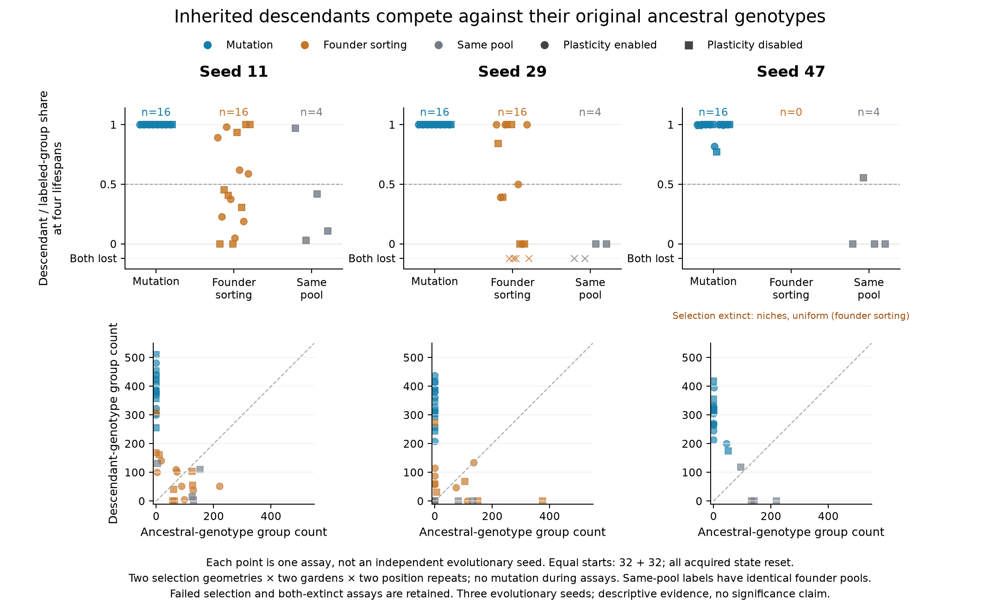

# Heritable performance improved in the funded selection study

All six mutation-enabled selection populations survived twenty founder lifespans. Their sampled descendants outcompeted the ancestral-genotype group in all 48 reciprocal common-garden assays; the ancestral group disappeared completely in 44, while four ended in coexistence. All 24 assays with plasticity disabled also favored descendants. This is evidence of heritable functional improvement in this model, beyond merely observing births or unique genotypes. It is not a demonstration of adaptive cooperation, new organism-level organization, or open-ended evolution.

The fixed [protocol](alife-adaptation-protocol.md) compares actual initial founder genotypes with terminal descendants in fresh environments. Both groups start with 32 organisms, equal material and chemical work, age zero and zero hidden/plastic state; all assay mutation is disabled. Labels pass to every offspring. Thus “ancestral group extinct” means its entire descendant lineage vanished, rather than just the initial individuals aging out. Four founder lifespans elapse during each assay.

| Selection seed / geometry | Mutation-enabled: positive assays / complete replacements | No-mutation: positive assays / complete replacements |
| --- | ---: | ---: |
| 11 / niches | 8 / 8 | 2 / 0 |
| 11 / uniform | 8 / 8 | 5 / 2 |
| 29 / niches | 8 / 8 | 5 / 4 |
| 29 / uniform | 8 / 8 | 1 / 1 |
| 47 / niches | 8 / 7 | Selection extinct; no assay population |
| 47 / uniform | 8 / 5 | Selection extinct; no assay population |

“Positive” means terminal descendant-to-ancestor log frequency change above zero from equal starts, using the preregistered .5 continuity correction. The mutation-enabled effects range from 1.207 to 6.929. When ancestors are absent, the corrected magnitude depends on that display correction and the surviving count; the raw population counts are therefore shown alongside shares. The 32 available paired mutation-minus-no-mutation contrasts are all positive (range .074–13.349, median 6.655). The two failed seed-47 selection controls are additional outcomes, not missing replicates to discard.

Controls matter. Selection among unchanged founder genotypes sometimes produces an advantage: 13 of its 32 assays have positive effects, seven completely replace the ancestral group, and four lose both groups. The twelve same-founder-pool label controls are also noisy: their log effects span −6.084 to +3.383, including two both-group extinctions and multiple one-group losses. Position, sampling and finite-population competition can create large individual imbalances. The mutation result is a consistent pattern across the three evolutionary seeds, not a significance claim based on treating its 48 assays as independent evolutionary replicates.

The positive result persists in both reciprocal resource geometries and with plasticity disabled. It supports general inherited performance improvement here. Most endpoints approach complete replacement, so these assays do not establish a specific home-environment advantage. The terminal genotype pool is abundance-weighted living survivors; it is not a sample of every genotype that appeared historically. A subsequent [ancestry-matched component transplant](alife-components-exploratory.md) separates evolved controller weights and metabolic traits, with substantial control noise and ceiling effects. No unselected mutation-only drift control was run, so the comparison concerns mutation-enabled selection rather than mutation in isolation.

The study retains twelve selection trajectories, eighty competition trajectories, twelve same-pool trajectories, exact founder genotype banks and 104 complete terminal checkpoints. Every sampled inspected state is finite, and every source budget remains positive. Maximum living generation reaches 221 in one no-mutation selection arm; generation count alone therefore does not establish novel adaptation. The largest absolute material residual across all retained samples is .33172 mass units, and the largest chemical-energy residual is 1.37335 work units. These are measured Float32 integration errors. Capacity matters: the largest competition-assay blocked-birth counter is 13,816, so the experiment measures competition in a bounded population rather than unrestricted growth. Blocking does not explain the whole pattern: all 39 mutation-enabled assays without blocked births favored descendants, with 35 complete replacements. All checkpoints report one identical set of loaded physics hashes.

Reproduction: `studies/alife_adaptation.jl` with `experiments/alife/adaptation.toml`. Full raw observations are in `outputs/alife-20261015/adaptation`; compact outcomes are [JSON](alife-adaptation-results.json), and the figure's exact individual-assay data are [CSV](figures/alife-adaptation.csv). `scripts/summarize_alife_adaptation.py` verifies every assay's birth/death accounting and every retained sample's finite state and unexhausted budgets. `scripts/inspect_adaptation_checkpoints.jl` extracts blocked births and stored group energy/material. `scripts/plot_alife_adaptation.py` produces the PNG/SVG and CSV without pooling the three seeds into a spurious large sample.
