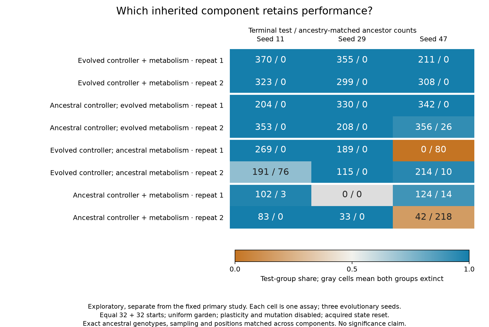

# Exploratory controller / metabolic component transplants

This separate follow-up asks which inherited component contributes to the primary study's descendant advantage. It does not change the fixed primary protocol or results. Settings are in `experiments/alife/components.toml`; implementation is `studies/alife_components.jl`; raw results are retained under `outputs/alife-20261015/components-exploratory`.

The three mutation-enabled, niche-selected endpoint populations provide descendants. Original founder ancestry IDs survived selection, so each sampled descendant is paired with its **own exact ancestral founder** from the archived genotype bank. For each seed and two position repeats, 32 descendants are sampled with replacement; their ancestor indices reconstruct a matched ancestral pool. Each of four test groups competes against that same reconstructed ancestral pool:

| Test | Controller weights | Allocation and metabolic traits |
| --- | --- | --- |
| evolved_both | Descendant | Descendant |
| ancestral_controller | Matched founder | Descendant |
| ancestral_metabolism | Descendant | Matched founder |
| ancestral_both | Matched founder | Matched founder |

Every assay is a fresh uniform-source garden for t=320, with 32 organisms per group and capacity 512. Mutation and plasticity are disabled; age, hidden state, plastic marks, energy, storage and material environment reset exactly as in the primary study. The same sampled descendant/ancestor indices, positions and group-label permutation are reused across all four components within a seed/repeat. Thus differences cannot be attributed to a different ancestral mixture or placement draw. The ancestral_both arm compares identical genotype multisets with distinct labels and positions.

Primary descriptive outcomes remain terminal group counts, corrected log frequency change, cumulative offspring and deaths, and both-group extinction. The study retains all 24 outcomes; three evolutionary seeds and two technical repeats do not justify significance claims. Hybrid genotypes are interventions on inherited components, not a demonstration of naturally occurring recombination. Component interactions and tradeoffs may prevent additive attribution.

## Completed outcomes

Evolved metabolic traits retain the more consistent isolated advantage in these assays. With an ancestral controller, the evolved metabolic component favors the test group in all six seed/repeat pairings, eliminating the ancestral group in five. Evolved controller weights with ancestral metabolism favor the test group in five of six pairings, with four complete replacements and one loss (seed 47, repeat 1). Both evolved components together replace the ancestral group in all six. These observations separate inherited neural weights from metabolic traits while retaining the same reset conditions; they do not establish that the controller contribution is uniformly beneficial.

Each entry below is terminal **test-group / ancestry-matched ancestral-group** population, including offspring of both labels:

| Seed / repeat | Both evolved | Evolved metabolism only | Evolved controller only | Both ancestral |
| --- | ---: | ---: | ---: | ---: |
| 11 / 1 | 370 / 0 | 204 / 0 | 269 / 0 | 102 / 3 |
| 11 / 2 | 323 / 0 | 353 / 0 | 191 / 76 | 83 / 0 |
| 29 / 1 | 355 / 0 | 330 / 0 | 189 / 0 | 0 / 0 |
| 29 / 2 | 299 / 0 | 208 / 0 | 115 / 0 | 33 / 0 |
| 47 / 1 | 211 / 0 | 342 / 0 | 0 / 80 | 124 / 14 |
| 47 / 2 | 308 / 0 | 356 / 26 | 214 / 10 | 42 / 218 |

The identical-genotype controls show substantial stochastic/spatial label imbalance, including one both-group extinction. Relative to those matched controls, the corrected terminal log effect is larger for metabolism-only in six of six pairs and controller-only in four of six. The both-extinct control's corrected zero is a convention, not neutral fitness. Many other endpoints have zero ancestors, making the correction and terminal population size determine the finite log magnitude. When both a hybrid arm and its ancestral/ancestral label control completely replace their competitors, their continuity-corrected log-effect difference is merely a difference in surviving population counts; it does not identify the magnitude of a competitive advantage. Strong identical-genotype label imbalances and these ceiling effects prevent a precise additive decomposition or a causal ranking of which component dominates. “More consistent” describes the observed outcome pattern in this small test, not an identified difference in component fitness. There is no significance claim from three evolutionary seeds.

All 24 assays and 984 sampled observations passed finite-state, positive-budget and exact group birth/death accounting checks. The largest absolute material and chemical-energy residuals are .0004463 and .018254. Frozen script copies and their recorded SHA256 fingerprints were checked against the executed experiment; all primary and component checkpoints use matching loaded physics hashes. A subsequent entry-point guard fix makes both studies callable through `bin/interior.jl study`; it changes dispatch only, and the output archives retain the exact pre-fix scripts that ran the experiments.

Exact outcomes, ancestry indices and cumulative offspring/deaths are in [compact JSON](alife-components-results.json); plotted individual observations are retained as [CSV](figures/alife-components.csv), with PNG and SVG alongside it. Full append-only histories and restartable terminal states remain in the separate output directory.
