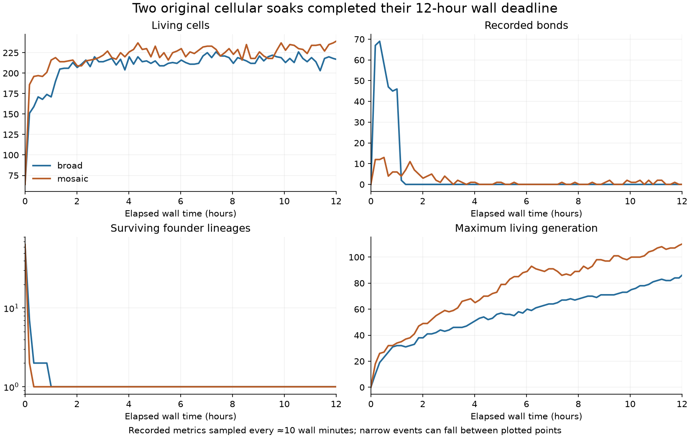
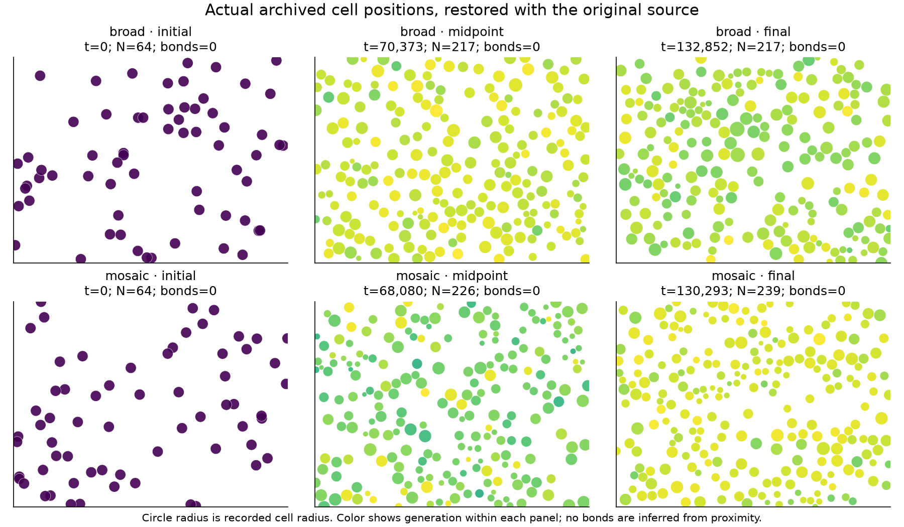

# Original cellular soaks: completed observations

The original broad and mosaic cellular runs each completed their intended
12-hour wall-time interval on 15 October 2026. Both status files report
`stopped / wall_time_complete`; their final restart pointers agree with their
last metrics steps. Neither run was resumed or reseeded for this review.
These observations concern the original source, not the separate optimized
continuation.

| Recorded quantity | Broad | Mosaic |
| --- | ---: | ---: |
| Final simulation time | 132852.002 | 130292.502 |
| Final step | 1328520 | 1302925 |
| Final living cells | 217 | 239 |
| Recorded population range | 64–230 | 64–250 |
| Cumulative births / deaths | 14267 / 14114 | 22047 / 21872 |
| Maximum generation among final living cells | 86 | 110 |
| Surviving founder lineages at completion | 1 | 1 |
| Final bonds | 0 | 0 |
| Maximum observed bonds | 334 | 423 |
| Metrics rows / immutable archived checkpoints | 2152 / 72 | 2152 / 72 |

Both populations remained positive at every recorded observation. Birth and
death counts continued to increase, while their populations settled into a
relatively narrow range. This establishes sustained turnover for these two
runs; it does not establish increasing behavioral complexity or adaptation.
The generation metric counts ancestry depth among living cells.

Founder-lineage diversity collapsed early. The transition to one remaining
founder lineage is bracketed by adjacent metrics rows at simulation times
15876.500–15962.500 for broad and 2949.500–3028.000 for mosaic. A surviving
founder lineage can contain many mutated genomes; this counter is not genome
or behavioral diversity.

Bonds became sparse after an early burst. Broad had positive bonds in 252 of
2152 observed rows, mosaic in 1154. The last observed positive count in broad
was one bond at t=90816.501; in mosaic it was one at t=130058.502, about 78 wall
seconds before its final row. Zero final bonds alone therefore does not mean
bonds never formed or that their loss was permanent during the run. The
cumulative junction-transfer counters ended at 1989.115 and 215.753.

The plot samples one metrics row every roughly ten wall minutes, plus exact
initial/final rows. Reported ranges, bond-positive row counts and transition
brackets above were computed from all 2152 rows per run. Short events and early
bond peaks can be absent from the plotted samples.

These six panels show actual initial, middle archived, and final checkpoint
positions and cell radii. They were deserialized with Julia 1.12.4 and the
original immutable source, using `restore_arena` with its source checks enabled,
then passed to `arena_snapshot` without taking simulation steps. The middle
frames are the 36th of 72 archives, not an interpolated midpoint. The images
show occupied cells distributed through the domain; they do not establish
persistent groups, cooperative organization, or causal benefits of adhesion.
No bonds are drawn from spatial proximity. Colors are normalized independently
within each panel and indicate generation.

## Preserved evidence and limits

[The compact JSON](cellular-soak-completion.json) preserves sampled trajectories,
all-row extrema, metrics chunk hashes, final pointer hashes, archive inventories,
and the recorded positions needed to regenerate both figures. The complete
metrics and checkpoint archives remain in their original hbox run directories,
`/othersys/tmp/intmat-soaks-20261015/{broad,mosaic}`; the review downloaded only
compact derived data, not the checkpoint collection.

Both runs have nine fully parsed metrics chunks with no incomplete tail. All
113 source-manifest files match their recorded hashes. The terminal checkpoint
hashes are:

- Broad: `d371e7f3d8f51dc9a3f48fd2ec90cda9a96a2b05c28e822d41ca08832e917fc7`.
- Mosaic: `f80bcbc69d64a8f990420ad2cc87210a54893696da118d45ec504b80d26096b7`.

Their final absolute material-accounting residuals are 0.002889 / 0.001447,
and chemical-energy residuals 0.009925 / 0.005274. These are reported accounting
residuals, not a separate numerical-convergence study. No failure files were
reported by the independent 20:48 inspection. Stable hashes and successful
restoration support restart readability; no continuation was performed.

`scripts/summarize_cellular_soak_completion.py` performs the read-only metrics
and source review on hbox. `scripts/extract_cellular_soak_frames.jl` extracts
recorded positions under the original project. With Matplotlib installed,
`python scripts/plot_cellular_soak_completion.py` regenerates the figures from
the committed compact JSON. Plotting was visually checked. Remote extraction
used CPUs 4,5, two Julia threads and an 8 GiB memory cgroup; it did not modify
simulation state, source files or checkpoint files.
