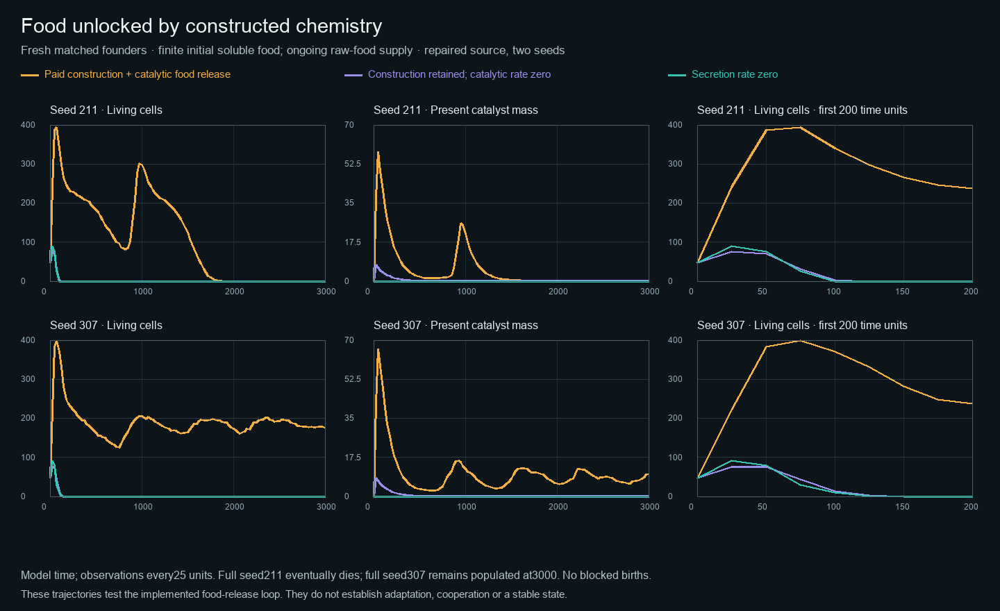

# Food released by constructed chemistry

The repaired, matched raw-food runs show that paid construction can sustain
substantial growth and turnover without a continuing soluble-food source.
The complete loop lasts much longer than either disabled control in both seeds.
It does not guarantee indefinite persistence: one complete run dies out around
time 1900; the other still contains 176 cells and 418 bonds at time 3000.

Each arm starts with the same 48 founders for its seed, on a physical 16×16
periodic garden represented by 32×32 sites. There is 0.3 initial soluble precursor
concentration of each kind, with no continuing soluble source. Raw feedstock
starts at concentration 2 of each kind and is supplied at 0.006 per unit volume
per unit time from finite funded reservoirs. The cells can release this food
through their paid catalyst. The two controls retain the same environment:

- `conversion_off` sets catalytic efficiency to zero but retains paid secretion,
  sorption capacity and transport resistance.
- `construction_off` sets secretion rate to zero, removing construction and its
  downstream catalytic, sorptive and transport effects.

All six arms run to time 3000 with step 0.1. Observations are taken every 25 time
units. “Extinct by” is the first recorded empty state, not the exact death time.
None reaches the population guard of 1,536 or records a blocked birth.

| Seed | Condition | Final cells | Births | Extinct by | Total constructed material | Raw food converted |
| --- | --- | ---: | ---: | ---: | ---: | ---: |
| 211 | Complete loop | 0 | 604 | 1900 | 119.85 | 5549.97 |
| 211 | Conversion off | 0 | 28 | 125 | 8.45 | 0 |
| 211 | Construction off | 0 | 42 | 100 | 0 | 0 |
| 307 | Complete loop | 176 | 840 | — | 257.56 | 10107.11 |
| 307 | Conversion off | 0 | 28 | 150 | 9.64 | 0 |
| 307 | Construction off | 0 | 43 | 150 | 0 | 0 |

The complete seed-307 trajectory repeatedly builds material after its initial
bloom. Its cells have experienced 840 births and 712 deaths by the endpoint.
These are ecological trajectories under an inherited, mutating controller, not
an adaptation assay. The contrasts test the implemented food-release loop;
they do not isolate a benefit of sorption or transport resistance, establish
cooperation between lineages, or demonstrate a stable state.

Every arm was restarted from fresh founders under one fixed physical source
after the earlier conversion-off run exposed a negative subnormal donor and an
unbounded rounding loop. The repaired degradation rule charges actual donor
endpoint changes and retains unrepresentable waste as explicit inert material.
That changes finite-precision behavior: the earlier completed seed-211 full run,
which survived through time 3000, is separate evidence and is not silently
substituted into this comparison. The new source's maximum sampled absolute
material and chemical-energy ledger errors across all six arms are respectively
0.000239 and 0.0000522.

The [compact results and source manifest](constructed-food-dependence.json)
include exact module overrides, driver and metric hashes, configuration,
observation bounds and numerical limits. The [recorded plotted points](figures/constructed-food-dependence.csv)
retain all six curves. Complete snapshots and checkpoints remain in the local
`outputs/constructed-food-fixed-20261015` directory.

## A slower catalytic regime

The next two-seed exploration changes only `catalytic_rate` from 6 to 0.3 in
[its recipe](../experiments/arena/constructed-food-slow-catalysis.toml). At raw
feedstock concentration 2, half-saturation 0.2 and supplied flux 0.006 per
chemical, a supply-matching estimate is `E = 0.006*(0.2+2)/(kcat*2)` for each
catalyst. The corresponding combined catalyst concentrations are about 0.0022
at rate 6 and 0.044 at rate 0.3. Matrix resistance 20 halves permeability at
combined concentration 0.05. Slower catalysis therefore brings these estimated
production and transport scales closer together.

This estimate is a motivation, not an optimum or a closed-loop prediction.
Sorption binds the soluble product, not the raw catalytic substrate; it reduces
or delays free uptake while retaining food locally. At total enzyme
concentration 0.044, binding capacity is 0.264, and adsorption/desorption kinetics,
local depletion, cellular demand, spatial transport and ongoing enzyme decay all
matter. The exploration preserves these interactions and the finite material
and work costs instead of prescribing producer identities or a colony reward.
It runs sequentially after the stronger-adaptation comparison under the same
two-thread budget, with a separate immutable source and output directory.
