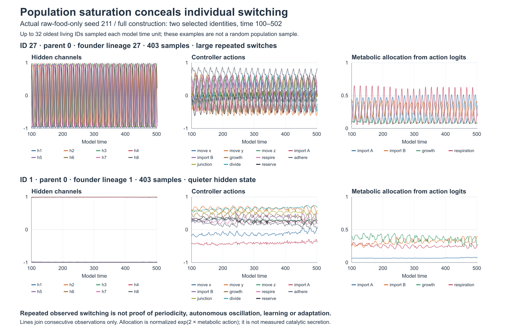

# Individual development in a constructed-food habitat

This report preserves the original source-pinned seed-211 trajectory under
`outputs/constructed-food-20261015`. It is separate from the later matched
repaired-source runs under `outputs/constructed-food-fixed-20261015` and
`outputs/constructed-food-slow-feedback-fixed-20261015`. The repair changes
finite-precision material transfers; it was followed by fresh-founder restarts,
not migration of this trajectory. The identities, figure and source hashes below
have not been replaced with results from those new runs.

The baseline raw-food-only run already contains strong repeated switching within
recorded cell identities, despite high population-level hidden-state saturation.
In seed 211, ID 27 changes across nearly the full hidden range while its actions
and metabolic allocation vary with it. ID 1, observed over the same interval,
keeps nearly constant saturated hidden channels while its actions still vary.
Stronger inhibition is therefore an experiment about the prevalence, persistence
and ecological interaction of developmental modes; it is not necessary to create
a capacity that the baseline lacks.

Both examples have 403 actual observations from time 100.00000149 to
502.00000748, with no observation gaps. Axes are fixed across identities. The
trace samples up to the 32 oldest living IDs each model time unit, rather than
a random population sample or a fixed cohort. The two examples were selected
after observing their different variability. ID 27's first hidden channel has
21 observed upward zero crossings; its 20 complete same-direction intervals span
18–19 time units, with median 19. This describes sampled recurrence timing rather
than establishing an autonomous oscillator. The allocation panel is calculated
from metabolic action logits, not realized growth or catalyst secretion.

The trajectory uses [constructed-food.toml](../experiments/arena/constructed-food.toml):
finite initial soluble food, continuing externally funded raw-feedstock supply,
shared finite anabolic material/work, and a catalytic sorptive matrix. It is not
the earlier refuges experiment with continuing soluble-food supply. The figure
and counts describe one completed seed-211 trajectory, not a comparison of
evolutionary performance.

Switching is not equally prevalent throughout the run. After time 100, 34 of the
54 observed identities have at least 100 samples; five show hidden sign changes,
including the large switches illustrated above. After time 1000, 144 of 164
observed identities have at least 50 samples; two retain strong switching, ending
their observations at times 1398 and 1545. From time 1600 through 3000, none of
44,736 consecutive sampled-ID pairs contains a hidden-channel sign change.
This is disappearance from the late oldest-32 sample, not proof that every cell
became constant or that each earlier switcher settled into a fixed state.
Indeed, full-population snapshots every 25 time units still capture five hidden
sign changes across 10,627 adjacent same-ID observations in that late window,
all in two IDs outside the oldest-32 sample. That coarse cadence can miss or
alias faster cycles; it supplies a useful check on the sampling limitation.

The full-population snapshots show changing ancestry alongside those dynamics.
At time 3000, all 203 living cells are represented: seven founder lineages remain,
with Shannon effective count 1.80. Lineage 23 contains 177 cells, displaying
177 cellular-controller and 147 catalytic-controller genome signatures. Founder
ancestry concentrating is therefore distinct from genotype diversity disappearing.

Material roles also vary over time. The table compares lineage 23 with the whole
living population; secretion is the actual transfer during the last `.1` time
unit, not cumulative contribution.

| Time | Lineage 23 share of biomass | Share of last-step catalyst secretion |
| --- | ---: | ---: |
| 1900 | 73.8% | 92.2% |
| 2500 | 60.1% | 97.7% |
| 3000 | 86.6% | 49.5% |

At the final step, lineage 24's six cells contain 3.09% of biomass but supply
44.54% of secretion. That endpoint contrasts with earlier steps where the
dominant lineage supplies most secretion. Sparse snapshots cannot recover exact
cumulative contributions by lineage or identify who built the persistent
surrounding catalyst. These observations support investigating changing
developmental and material roles; they do not establish functional dependence,
cooperation, learning or adaptation.

[Compact results and source hashes](constructed-food-development.json),
[exact selected observations](figures/constructed-food-individual.csv), and the
[vector figure](figures/constructed-food-individual.svg) accompany the report.
Loaded physics hashes were checked against the pinned source; full traces remain
under `outputs/constructed-food-20261015`. The helper and additional lineage
summaries are retained in `outputs/constructed-food-analysis-20261015`.
