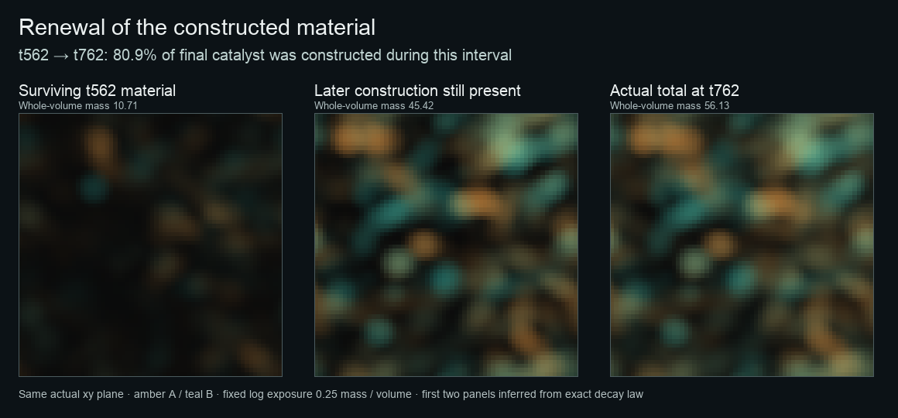

# Constructive ecology in three dimensions

`studies/constructive_volume.jl` runs the shared anabolic law, catalytic habitat
and sorptive matrix on an actual three-dimensional grid. Cells retain physical
positions, spherical radii and stable-ID bonds. Raw chemistry volumes accompany
an ordinary viewer snapshot, which is explicitly a central slice.

```sh
OPENBLAS_NUM_THREADS=1 julia --project=. --threads=2 --gcthreads=1 \
  studies/constructive_volume.jl experiments/arena/constructive-volume.toml \
  outputs/my-fresh-volume 24 3000 50
```

Arguments after the output are resolution, steps and capture interval. The extent
stays 12³ when resolution changes. Initial concentrations, supply rate densities,
physical exchange radius and cell positions are preserved; independently sampled
fields and nonlinear trajectories need not match bitwise across resolutions.
Indexed genome storage is enabled explicitly by the study, without changing the
cellular law. Every run uses a fresh output directory and records source hashes,
its complete configuration and strict initial/middle/final checkpoints.

Each sampled directory contains `geometry.json`, `snapshot.json`, `volume.json`
and seven Float32 arrays in Julia/Fortran axis order: catalyst A/B, retained food
A/B, free precursor A/B, and combined permeability. Chemistry is mass per physical
volume; permeability is dimensionless. `volume.json` records shape, extent, time
and raw-file hashes. Geometry positions are centered physical coordinates; bonds
cross periodic boundaries by their shortest wrapped displacement. A renderer
must distinguish an optical cutaway or chosen field interface from anatomy.

The first source-pinned 24³ smoke run (2220f5a plus this study) reached time 10:
320 founders became 647 cells, with 80.83 units of paid catalyst and 396.01 units
of retained food. Its maximum observed material and chemical-energy ledger
errors were 3.56e-6 and 1.08e-5. The longer pilot reached 2,711 cells and 7,073
bonds at time 40, with no capacity-blocked births. Its full volumes and selected
frames are retained under `outputs/constructive-volume-20261015` locally and
`/othersys/tmp/intmat-constructive-volume-20261015` on Hbox.

The 3,000-step pilot completed time 300 in 941 seconds including exports: 2,109
cells, 2,514 births, 725 deaths, 5,497 bonds and no blocked births. It retained
63.17 units of catalyst and 73.00 units of bound food. Maximum observed material
and chemical-energy ledger errors were 9.81e-5 and 6.82e-5. This is a recorded
construction/turnover trajectory, not an evolutionary assay.

Resource diffusion subcycles internally, so the arena timestep remains 0.1 at
64³. The study records each soluble species' explicit diffusion limit and actual
substep count, together with hashes of the study and profile files themselves.

This is a dense **soft-contact** regime. At time 40 the summed physical body
volumes exceed the domain volume, so spheres substantially overlap; the current
mechanical law is not an incompressible-cell solver. Contact compression is
observable to the controller. Rendering those spheres does not establish a
sealed tissue or mechanically solid matrix: the constructed matrix currently
changes chemistry and transport, not contact stiffness.

`constructive-volume-density4.toml` explores fourfold material density with the
same mass and chemical funding. Smaller physical bodies leave more packing room
around the chemistry. This is a distinct physical regime, not evidence of grid
convergence or a change made inside an existing trajectory. The 24³ pilot and its
original source remain intact.

Two further recipes explore the same construction law in 2D.
`constructed-food.toml` retains finite initial soluble food but supplies only raw
feedstock afterward. `constructed-food-slow-feedback.toml` additionally raises
slow inhibitory adaptation strength from 0.3 to 1.5 and its timescale from 6 to 8.
That is an analytical attempt to open more temporal developmental behavior; it
does not prescribe oscillation. These are exploratory ecological regimes, not
claims of evolved improvement or hard-wired cooperation.

The 64³ density-four run completed time 300 in 2,072.49 seconds including
exports: 1,761 cells, 2,717 births, 1,276 deaths, 3,451 bonds and no blocked
births. Catalyst mass was 92.196, retained food 187.888, and cumulative paid
construction 651.517. Maximum observed material and chemical-energy errors were
9.92e-6 and 3.17e-5. Following the bloom, construction per model-time unit was
0.0776, 0.1526, 0.2826 and 0.3104 in successive 50-time intervals from 100 to
300; deaths in those intervals were 486, 288, 148 and 105. Construction remains
below catalyst decay, but the later trajectory is not simply a passive remnant.
These observations motivate continuation; they do not establish adaptation or
persistent collective organization. Density and resolution both differ from the
24³ pilot, so this is not an isolated grid-refinement comparison.

The study also accepts a strict checkpoint continuation:

```sh
julia --project=PATH_TO_ORIGINAL_SOURCE --threads=2 --gcthreads=1 \
  studies/constructive_volume.jl PATH_TO_ORIGINAL_PROFILE \
  outputs/a-fresh-continuation 64 11980 200 PATH_TO_PARENT_CHECKPOINT 9000 2000000000
```

The last three arguments are the parent checkpoint, wall budget in seconds after
initial export, and artifact budget in bytes. Restore still requires the original
physical source. All recipe settings must match the checkpoint; only Arena's
derived initial-energy ledger metadata is excluded from recipe comparison. The
new driver records its own hash, parent checkpoint hash, initial step/time and
stop reason, preserves genome storage, and reserves checkpoint space before
stopping. It never replaces an earlier trajectory or deletes its artifacts.

The density-four continuation uses the original 2220f5a physical engine. A
separate 20-step restore/export check passed from step 3000 to 3020 with matching
source and parent hashes. The longer run starts from that completed check and
targets time 1500 with a 9,000-second wall budget, two CPU threads, an 8 GiB memory
limit and a 2 GB artifact budget. This is an explicitly recorded continuation,
not a claim that the original study driver ran uninterrupted.

A sampled contact-graph readout gives the later 3D material a more concrete
structure: at time 300 its largest component contains 1,520 of 1,761 cells and
261 founder lineages. There are 238 isolated cells and one three-cell component.
In the full population, 274 of the 320 founder lineages remain; the largest has
37 cells. Only 31.5% of bonds join cells from the same founder lineage. Of 2,859
bonds at time 200 whose two endpoints survive to time 300, 2,596 are observed
again. That is endpoint reobservation across a 100-time gap, not proof that each
bond persisted uninterrupted. A large mixed contact network is not by itself a
cooperative organism or a distinct unit of selection. The readout and source
snapshot hashes are retained in `density4-graph-readout.json` under the local
volume output directory; `density4-temporal-sections.png` shows the same physical
plane at times 30, 100 and 200 with fixed field exposure.

The original-source continuation has also provided a direct material-turnover
readout. Between times 562 and 762, catalyst mass changes from 53.0557 to 56.1315.
Catalyst has no transport in this law, and its only sink is exponential decay at
rate 0.008. Consequently, 10.7118 units of the final material are surviving
material already present at time 562; the remaining 45.4197 units, or 80.92%,
were constructed during the interval and have survived to time 762. This is
later construction still present, not cumulative secretion or an attribution
to particular lineages. Float32 field-export uncertainty in this mass difference
is below 0.000008. The original simulation's floating-point accumulation is a
separate numerical limit. The [compact provenance and calculation](figures/constructive-volume-catalyst-turnover.json)
retain field hashes, the physical source and parent checkpoint; the figure below
shows a fixed-exposure physical-plane decomposition alongside the actual final
field. The first two panels are inferred from the decay law; the third is the
recorded total. At time 782, the next observation contains 1,688 cells and 56.3491
units of catalyst. This later rise is an observation, not a stable-state claim. Continued construction here occurs under the original funded 3D recipe,
which still supplies some soluble precursor; it does not establish dependence
on the constructed habitat alone.



The bounded continuation subsequently completed time 1500 on its original physical
source. It ends with 1,693 cells, 455 bonds, 63.318 catalyst mass and 86.017 bound-food
mass; cumulative paid construction reaches 1,227.986, with no blocked births.
The later material was renewed while the initially dense contact graph changed
substantially. These observations do not establish a stationary state or
functional dependence. The final complete checkpoint restored strictly under
its matching source, and a hash-verified copy is retained locally.
[Completion, accounting and source provenance](constructive-volume-continuation.json)
record the final state and the separate continuation's parent.
