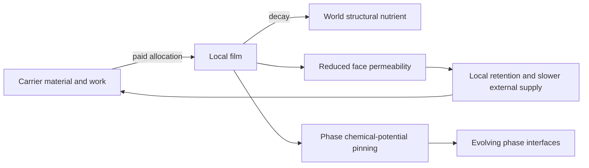

# Funded boundary maintenance

`BoundaryMaintenance` owns a local, decaying film separately from mineral
`world.fields.deposit`. `maintain_boundary!` accepts a cell, available material,
available work and requested mass, then returns the actual material and work
transferred. The caller must debit these exact amounts. Maintenance without
both budgets produces no film; requesting zero implements withholding. Work is
irreversible dissipation, not stored chemical fuel. Film has zero chemical
potential in the resource ledger. Its decay returns structural material to
world nutrient; it does not regenerate chemical energy.

The process wraps one `ActiveMedium` advancement. During that call it projects
film plus mineral into the medium membrane field, then restores the exact saved
mineral array in `finally`. Thus the existing symmetric face transport and
chemical-potential pinning operator sees film without a second medium stage or
an overwritten forcing channel. Advance the wrapper, then its referenced phase;
do not also advance the medium. Persistent snapshots distinguish film and
mineral. The wrapper records all medium state under `medium_` prefixed names;
the referenced phase is recorded as its own stage.

A film cell resists exchange across both adjacent faces, so neighboring carriers
can receive the same retention benefit without paying. Sharing complementary
metabolic products can make retention useful to multiple carriers. Conversely,
film can obstruct supply and make a contributor worse off. Neighbor exposure
(`local_boundary_benefit`) measures local film, not cooperative fitness. A claim
of mutual advantage requires comparing realized uptake, work, survival or
reproduction for both metabolic types against matched withholding controls.
These rules support that experiment; they do not guarantee its outcome.

Material accounting includes `boundary_material_mass(b)` once, in addition to
world and carrier inventories. `contributed_material`, `spent_work` and
`recycled_material` are cumulative audit diagnostics, not extra reservoirs.
The current operator is CPU-only through ActiveMedium and has no prescribed
organism silhouette or boundary growth target.
