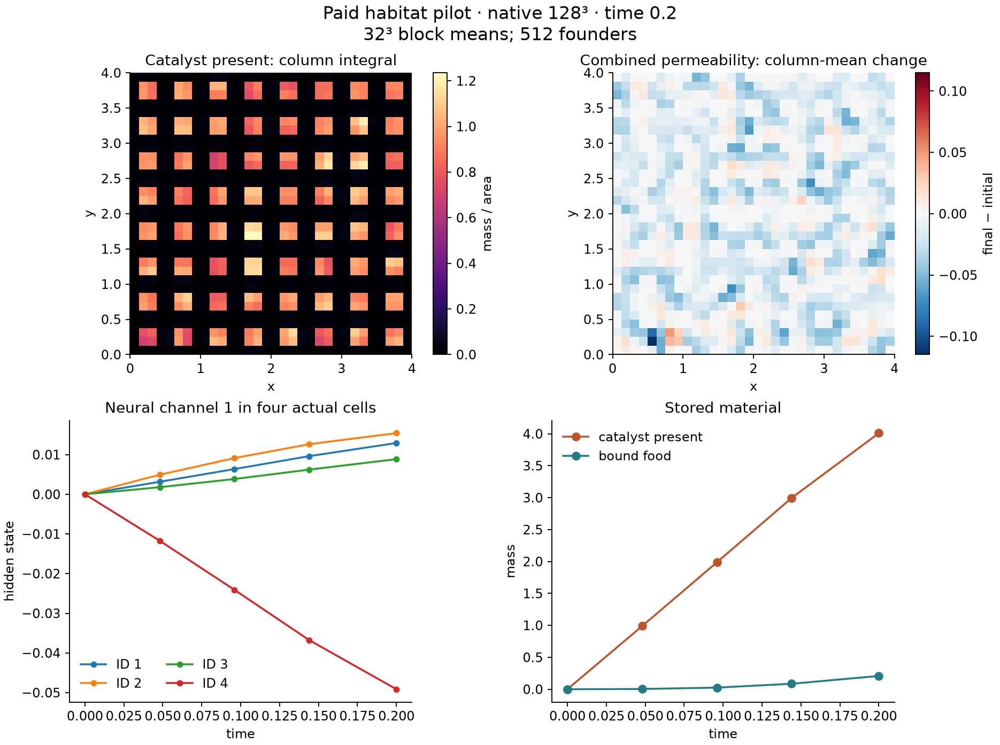

# Physical-support storage and complete GPU steps

The first native AMD measurement is a tradeoff: axis descriptors greatly reduce
support storage but slow complete steps. Materialized support remains the default.
Both representations retain the physical exchange radius and the same declared
cellular law. This result does not support an axis throughput improvement.

| Native grid | Materialized steps/s | Axis steps/s | Paired axis speedup | Support storage reduction |
| --- | ---: | ---: | ---: | ---: |
| 64³ | 77.30 | 41.29 | 0.538× | 20.1× |
| 128³ | 31.58 | 7.95 | 0.252× | 63.1× |
| 256³ | 5.32 | 1.00 | 0.189× | 221.1× |

These are three alternating paired samples of 30 complete steps on the RX 6750 XT,
Julia 1.12.4, pinned AMDGPU 2.8.0, with the documented process-local device opt-level
1 compiler workaround. Each sample starts with 512 founders and capacity 2,048,
and performs 511 births, one death, contact work, transport, metabolism and neural
updates. There were no blocked births. Times include compact failure/observation
checks every eight steps; construction, compilation gates and final biological
reads are excluded. Identities, final positions, hidden states and bonds matched
exactly in all nine pairs. Smaller CPU/AMD gates also compared the full fields and
checked exact checkpoint restore and continuation; dense and axis habitat gates
passed in native 3D.

Extent 4, radius 0.18, density 128, macro timestep 0.001, diffusion 0.001 and 16
mechanical substeps are fixed across grids. Increasing the grid is spatial
refinement; no cross-resolution trajectory equivalence is claimed. At 256³,
support arrays shrink from 287,973,376 to 1,302,528 bytes. The 221× figure concerns
support only: full-volume chemical arrays still dominate total memory. It is not
a 221× reduction in whole-process RAM or VRAM.

The original axis iterator decodes its flat candidate cursor with integer division
and remainder. A subsequent carry `(x,y,z)` implementation preserves the exact
candidate order and Float32 grouping. It passes 69 complete device assertions and
30 frozen-reference edge assertions, including inactive, fallback, thin and
asymmetric supports. A fresh AMD repeat changes only the support helper from
`7d3caeb` over the original numerical baseline:

| Native grid | Materialized steps/s | Carry axis steps/s | Paired axis speedup |
| --- | ---: | ---: | ---: |
| 64³ | 76.79 | 46.13 | 0.601× |
| 128³ | 31.54 | 9.43 | 0.299× |
| 256³ | 5.33 | 1.22 | 0.230× |

All nine repeat pairs matched identities, positions, hidden states and bonds
exactly, and the complete base and paid habitat gates passed again. Support
storage is unchanged. Carry axis rates were 12–22% higher than the earlier flat
run; these are separate runs, rather than alternating carry-versus-flat samples.
The measured carry path remains slower than materialized support, by about 4.35×
at 256³. Its purpose is a tested memory option, not a throughput default.

## A paid 128³ habitat pilot

A separate closed 200-step pilot used 512 founders, capacity 8,192 and the same
physical extent/radius. The exact Float32 initial inventory could fund at most
5,827 live cells at minimum mass, so the safety cap was above the complete funded
population bound. The pilot remained at 512 cells and developed 29 bonds, paid
4.013 units of catalyst, converted 2.284 units of raw substrate, and held 0.208
units of bound food. This is time 0.2, not a demonstrated long-lived ecology.

Material residual was 4.72e-5 over 1,456.64 units; chemical-potential/work/heat
residual was 5.89e-4. Checkpoint restoration and a further 20-step continuation
matched exactly. The main loop took 49.784 s (4.017 steps/s), including first-use
compilation, batch checks and five captures. This pilot rate is not a warmed
throughput benchmark. Construction, full audits, checkpoint and continuation
bring the complete pilot to 80.37 s.

The pilot owns 618 MB of array data and stores 624 MB including its complete
checkpoint. Its five detached frames contain 32³ block-mean concentrations of
free food, raw substrate, catalyst and bound food, permeability, actual cell
positions/IDs/lineages/bonds, and selected neural/action histories. The field
samples are block means; they do not replace the native 128³ physical state.

Numerical source is frozen at `d4d152d`, scripts at `25fcae3`; the copied Linux
manifest changes only Interior's path. Compact measurements and exact hashes are
in [device-support-results.json](device-support-results.json). Reproduce with
`scripts/benchmark_device_support.jl` or the budgeted
`scripts/run_device_habitat_pilot.jl`. The hbox launcher requires an explicit
copied `DEVICE_PROJECT`; it never changes installed packages. `closed` and
`finite_sources` are separate pilot variants, and prescribed source budgets enter
the capacity forecast before any trajectory steps.

The early catalyst patches retain the seeded jittered lattice arrangement. The
permeability panel includes body motion and paid material together. These actual projections and histories describe early material
deposition over 0.2 model time. `scripts/export_device_habitat_frames.jl` decodes the
detached frames using only Julia stdlibs; `scripts/plot_device_habitat_pilot.py`
produces the diagnostic from the exported arrays.
