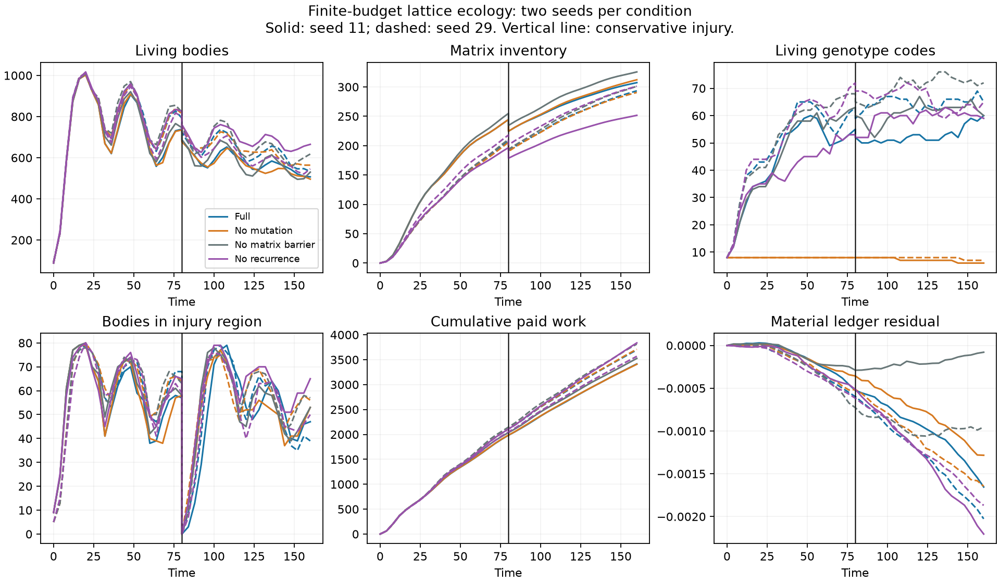
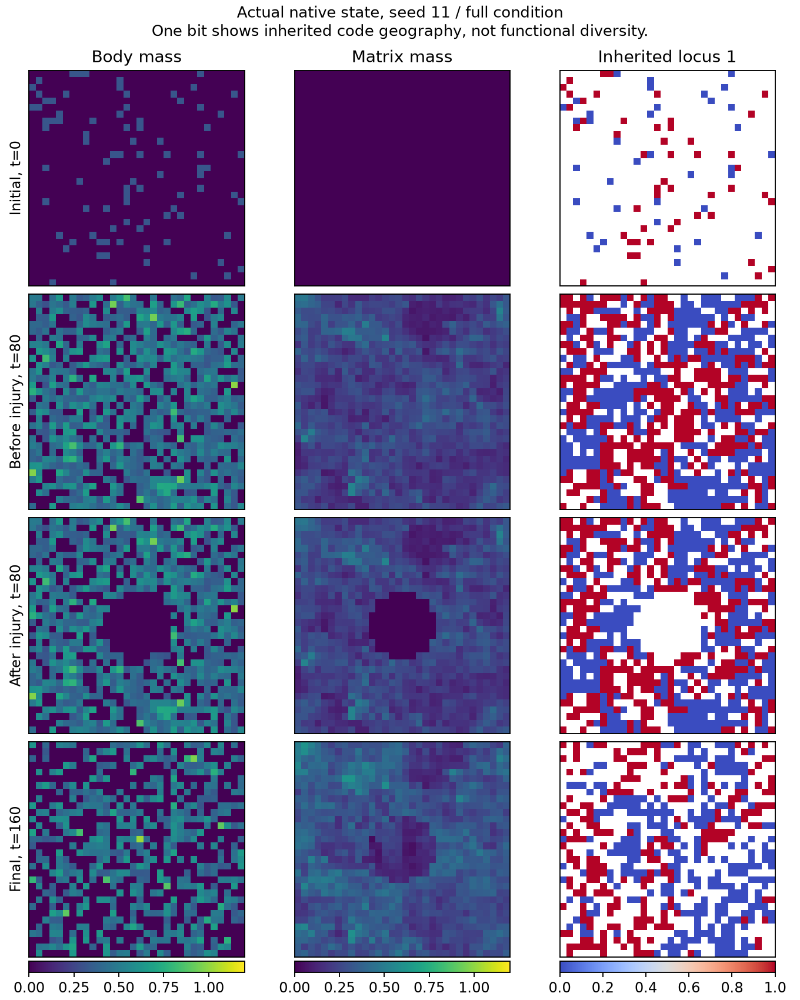

# Fixed-voxel evolving ecology: a separate material law

This Julia study explores an alternative to moving-agent contacts: a fixed lattice carries living occupancy, material inventories and inherited recurrent policies. It preserves the previous arenas, cellular mechanics and continuum packing laws. It is a working local-kernel prototype, not a GPU performance result or a claim that rich multicellular organization has already emerged.

## Why this representation is worth exploring

Dense cellular mechanics pays for spatial support, contact neighborhoods, bond bookkeeping and displacement solves. A fixed occupancy lattice supplies exclusion and an O(1) neighborhood directly. Three KernelAbstractions passes advance each complete step: symmetric diffusion / finite-reserve release, voxel-local recurrent chemistry, and a disjoint nearest-neighbor contact matching. There is no contact search, spatial sorting, scatter accumulation, host population loop, mutation allocation queue or compaction. All buffers are preallocated. A rotating axis/parity schedule visits every nearest-neighbor face; periodic sides must be even or singleton so no two contacts own the same endpoint in one pass.

This changes the model. Each occupied voxel is one reproducing individual, with variable body inventory but no resolved shape or mechanical force solve. Larger grids at fixed spacing enlarge the domain; refining spacing while retaining the same per-voxel individual changes the ecological representation. It is complementary to deformable cells and volume-filling continuum tissue. Dense kernels may outperform contact mechanics in dense regimes, but sparse moving populations can avoid the work of empty voxels. Only a complete device implementation gate and sustained measurements could establish the actual tradeoff.

Each individual has four recurrent channels. Nine local observations (food A/B, structural precursor, matrix, body inventory, stored work, age, neighboring occupancy and food contrast), a constant bias and those four channels feed eleven outputs: four hidden targets and seven flux/event gates. Policy evaluation requests uptake allocation, feeding, growth, construction, erosion, hopping and division. Recurrent updates are bounded and charged an explicit abstract maintenance cost; this is not a calibrated FLOP-to-joule model. No offline training or within-life weight plasticity occurs. Hidden state follows hopping and resets at birth; genotype does not reset.

## A shared finite genotype space

Twelve binary loci select among 4,096 immutable recurrent rules. Each rule has 154 Float32 weights generated from a common founder prior plus twelve coherent perturbation directions. A funded birth inherits the parent's index and may flip one locus. Thus mutation can introduce a previously absent heritable combination without allocating or copying a genome into each voxel. It is a declared finite genotype space, not open-ended genomic innovation. Distinct indices do not establish functionally distinct phenotypes.

The shared lookup occupies about 2.41 MiB. A hypothetical 154-weight copy at every 128³ voxel would occupy about 1.20 GiB; the complete prototype's other arrays scale at approximately 180 bytes per voxel (about 360 MiB at 128³), plus that shared table. This is a representation budget, not measured device speed. At tiny grids the lookup can be larger than a per-voxel table: its memory advantage begins when voxel count exceeds genotype count. Rule tables trade exponential locus count for low per-voxel state; a larger genotype model would need a different cache or encoded parameter representation.

Founder policies have disclosed feeding, growth and division priors, with random recurrent couplings and heritable perturbations. This supplies viable reproduction primitives; it does not mean life or anatomy evolved from an unconstrained random network. Initial positions are random sparse occupancy and initial matrix is zero.

## Exchange and energy contract

All quantities below are nondimensional per-voxel **inventories**, not neural hidden channels or renderer colors.

| State | Transfer / role | Chemical potential |
| --- | --- | ---: |
| Dissolved foods A/B | Diffuse symmetrically, oxidize locally | 4 / 3 per mass |
| Finite immobile reserves A/B | Transfer the actual representable reserve debit to the corresponding food | 4 / 3 per mass |
| Structural precursor | Diffuses; paid growth incorporates it into bodies | 0 |
| Body inventory | Hops with identity; paid division splits it; construction transfers it to matrix | 0 |
| Immobile matrix | Restricts transport and free occupancy; paid erosion / passive decay return precursor | 0 |
| Spent fuel | Receives consumed food mass, cannot replenish fuel | 0 |
| Stored work | Pays maintenance, growth, matrix remodeling, motion and division | Work inventory |
| Heat ledger | Receives oxidation inefficiency and every paid work debit | Dissipated work |

Total material is foods + reserves + structural precursor + bodies + matrix + spent fuel. Total chemical energy is food/reserve potential + stored work + cumulative heat. The model is closed with finite reserves; it cannot run indefinitely by recycling spent material. Growth and construction spend declared positive work costs. Uptake is bounded by available food and stored-work capacity. Birth requires enough body inventory for two minimum individuals, paid work and target capacity. Hopping carries body, work, age, hidden state, genotype, lineage and persistent identity together; matrix remains in place. Death transfers body to precursor and remaining work to heat. Physical updates never average unrelated hidden bases between genotypes.

The matrix changes symmetric face permeability and shares a capacity constraint with bodies. These are modeled consequences, not a claim of load-bearing mechanics or cooperation. Simultaneous recipient conflicts are eliminated by the contact matching rather than repaired after an overdraw. Environment diffusion uses an immutable snapshot, and neighboring occupancy is sampled before the local chemistry pass, avoiding concurrent read/write races.

The optional declared injury clears a central region at a specified time. It transfers body and matrix to local precursor and remaining stored work to heat, retaining food and reserves. Recovery therefore needs actual local transport, reproduction and funded reconstruction. The imposed wound is not spontaneous architecture, and recovery alone does not establish evolved regeneration.

## Reproducible CPU laboratory

The law is `studies/lattice_ecology.jl`; the bounded runner is `studies/lattice_ecology_run.jl`. Run:

```sh
JULIA_NUM_THREADS=1 OPENBLAS_NUM_THREADS=1 julia --project=. studies/lattice_ecology_run.jl experiments/alife/lattice-pilot.toml outputs/my-lattice-pilot
```

Use a new output directory. The runner is deliberately bounded to 4,096 CPU voxels and 10,000 steps; larger or GPU work requires separate resource coordination. Kernels use Julia/KernelAbstractions with Float32 physical state and owner-local compensated heat accumulation. No GPU launch or backend equivalence has been tested for this law. Small 2D and 3D CPU tests are execution evidence only.

The first matched experiment uses seeds 11 and 29 on 32² sites, finite complementary food reservoirs, and four conditions: full; mutation disabled; transport barrier disabled while retaining costly matrix; recurrence disabled while retaining the same flux priors and maintenance cost. It advances to t=160, with a conservative injury at t=80. Niches are imposed opportunities, not evolved specialization. The no-transport-barrier arm removes one material consequence, not every matrix feedback. The no-recurrence arm removes temporal policy feedback, not metabolism or heritable policy variation.

Append-only scalar trajectories retain budgets, paid work, births/deaths, hopping, mutations, founder lineages, genotype diversity, generation, occupancy/matrix components and injury-region recovery. Full native Float32/Int32 frame data retain actual material and genotype fields. Exact restart checkpoints pin the study source, loaded core source hashes and Julia version; an archived source snapshot accompanies each experiment. Generic native recording exposes the owned process through the normal composition interface. Frame observations never advance the process.

A same-geometry throwaway specimen warms the kernels before measured runs. Reported complete-step throughput includes diffusion, neural chemistry and contact events, while capture time and warm-up are separate. It is not a controller-only number or a GPU estimate. Conservation residuals are measured Float32 errors, not assertions of bit-exact real arithmetic. Sub-ULP reserve requests stall rather than crediting unwithdrawn fuel. Affordability rounds flux down before charging a non-overdrawing representable work debit; any extra debit quantum dissipates and never amplifies neural activity. Prices that round to zero cannot buy physical growth/remodeling/hopping. Inventory overflow, invalid battery capacities and aliased owner buffers fail preflight. Early exploratory outputs predate these audit fixes and are retained separately; the reviewed experiment is the version to analyze.

## Reviewed execution, 2026-10-15

Eight matched 32² runs completed under the frozen law: two seeds in each of four conditions. All sampled states passed physical validity checks. The largest absolute sampled material residual was 0.002205 against initial material 17,538.56; the largest energy residual was 0.001629 against initial accounted energy 59,164.16. These are numerical errors in a declared ledger, not extra resources available to organisms.

| Seed | Condition | Final bodies | Living codes | Maximum generation | Injury region: before → after → final |
|---|---|---:|---:|---:|---|
| 11 | full | 507 | 60 | 23 | 57 → 0 → 47 |
| 11 | no mutation | 496 | 6 | 23 | 58 → 0 → 53 |
| 11 | no transport barrier | 530 | 60 | 19 | 58 → 0 → 53 |
| 11 | no recurrence | 665 | 59 | 21 | 65 → 0 → 65 |
| 29 | full | 533 | 65 | 19 | 68 → 0 → 39 |
| 29 | no mutation | 564 | 7 | 22 | 64 → 0 → 56 |
| 29 | no transport barrier | 618 | 72 | 19 | 63 → 0 → 57 |
| 29 | no recurrence | 546 | 65 | 22 | 59 → 0 → 50 |





This establishes funded turnover, mutation, inheritance, migration and recolonization in an executable spatial material law. It does not establish an adaptive advantage from mutation, recurrence, or matrix barriers. Controls also recolonize, and full-condition populations do not consistently exceed controls. The final matrix threshold set is nearly domain-wide; connected occupancy and matrix components are descriptors, not discovered multicellular organisms. One inherited bit in the diagnostic image shows code geography, not a functional phenotype. The finite complementary niches and viable initial policy priors were supplied by the experimenter. The niches activate one reserve source per site; a future uniform two-source comparison must normalize total feed opportunity rather than merely reuse the same per-source rate.

A separate 16³ CPU run completed 800 steps to t=80, including a spherical injury at t=40: 3,009 final bodies, 10,874 births, 8,236 deaths and 447 mutation events. Its final material/energy residuals were +0.000188/−0.000191. This is genuine volumetric execution evidence, not a 2D image extruded into 3D or a device performance result. Native fields and final restart state are retained in `outputs/alife-20261015/lattice-volume-reviewed`.

### Performance and verification

The focused test file passed **95 assertions**, including funding boundaries, finite inventories, alias rejection, identity-preserving transport, heritable division, starvation, conservative injury, 2D/3D continuation and checkpoint edge cases. The reviewed source corrected per-voxel closure boxing by constructing a concrete immutable input tuple. The controlled current-source probe below starts allocation and timing windows from identical warmed states and checks identical final arrays. It measures the complete three-pass physics step on one CPU thread; host validation and launch overhead are included.

| Grid | Allocated bytes / step | Voxel steps / second | Population during timing window |
|---|---:|---:|---|
| 8² | 50,656 | 1,261,291 | 62 → 64 |
| 16² | 50,656 | 848,280 | 254 → 256 |
| 32² | 50,704 | 539,469 | 993 → 1024 |
| 64² | 50,704 | 144,848 | 3948 → 4091 |

Allocation is effectively independent of voxel count in this range. Throughput decreases markedly in these almost full specimens as the working set grows; the experiment does not demonstrate linear wall-time scaling. The less crowded ecological runs measured 0.81–1.71 million voxel steps/s under their own occupancy trajectories. These are different workloads: neither comparison supports an old/new speedup factor. Earlier exploratory timings used different source and fixtures, so no order-of-magnitude improvement is claimed. Device compilation, device numerical parity and device throughput remain untested. Shared-bank memory saves per-voxel genomes only when voxel count exceeds the finite genotype-bank size; at these small sizes the bank itself dominates.

Machine-readable results: [eight-run summary](lattice-ecology-results.json), [trajectory CSV](figures/lattice-ecology-trajectories.csv). Reproduce figures with `scripts/plot_lattice_ecology.py`; reproduce the current complete-step probe with `studies/lattice_ecology_benchmark.jl`. Raw reviewed data, exact model/runner copies, recipes, frame channels, checkpoints and loaded core hashes remain under `outputs/alife-20261015/lattice-pilot-reviewed`; benchmark data are `outputs/alife-20261015/lattice-benchmark-paired.json`. Earlier pilot directories remain historical and are excluded here.

Frozen model SHA256: `e6d6cab2b0624965a5e7ec66b7f9f9ce44a01f9ded5653db660de61368cde9b5`. Runner: `90f0b8cf022991047162a68f3056b22d905fed495058bdc53e032993c2eaa0b5`. Tests: `72973c62fe2e62f28eddb4ec401d9b55d36c16555419a9b0f7827dfdeb3b4a1a`.

A stronger next experiment should transplant frozen descendant policies against matched founder policies into fresh reciprocal niches, resetting hidden state, age, positions and inventories. Predefine success by offspring and paid survival over a fixed window, retain failed/extinct populations, and include mutation-off selection plus same-pool label controls. Only a measured heritable performance change would justify calling this lattice study adaptation. Longer runs and richer mechanical couplings may change its organization, but this initial observation neither proves that promise nor rules it out.
