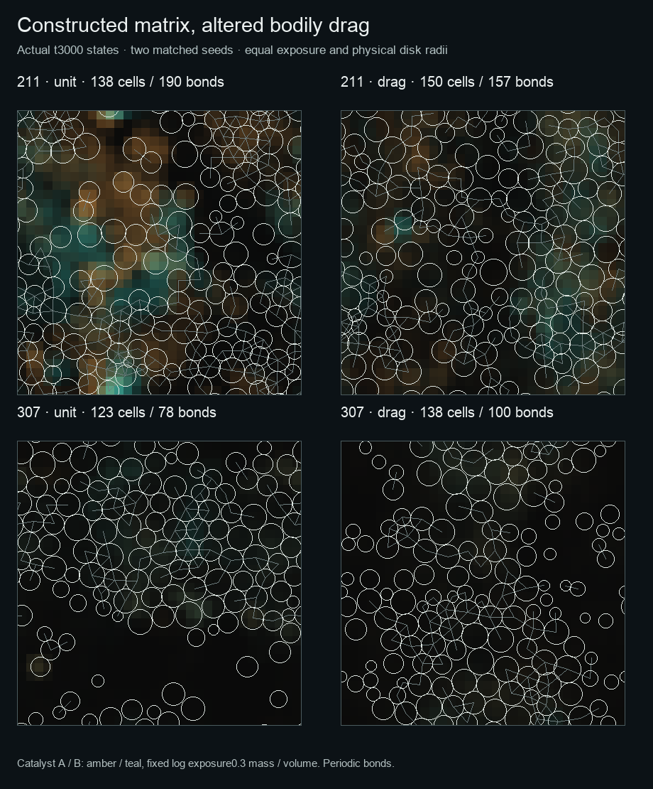

# Constructed matrix changes bodily drag

`MatrixDrag` is an optional mechanical consequence of paid catalytic material.
The existing construction law makes a spatial catalyst field that releases food,
retains soluble precursor and resists precursor transport. This extension also
lets that material affect how bodies move through the places they have built.
It applies to every body at a location, without lineage-specific benefits.

At the start of each constructive step, a cell samples total catalyst
concentration `E` over its physical exchange support. The held drag multiplier is

```
zeta = 1 + resistance * E
```

`resistance` has units of physical volume per catalyst mass. The same sampled
value informs the cell's extra respiratory work forecast and its mechanics:

- Motor motion retains its desired-velocity control. Actual drag work becomes
  `motor_cost * zeta * |displacement|^2 / substep_time`; a cell that cannot pay
  reduces its motion. Positive contact-potential increase is funded separately
  by the existing motor allocator. Downhill motion never credits chemical work.
- Passive contact relaxation uses velocity `force / zeta`. Its accepted step
  must still decrease contact potential, and both displacement and stiffness
  bounds include the altered mobility.

The outer-remaining-time motor reservation, each substep's budget check and the
final work debit all use the same multiplier. Terminal cells leave before
mechanics; stable IDs preserve the surviving cells' earlier observations.
Daughters are born afterward and sample their own environment next step. Newly
secreted matrix therefore changes drag on the following step, rather than
changing a cost after the current respiratory forecast was made.

This is a deliberately simple viscous law. It adds no stored elastic energy or
new material inventory. Motor expenditure remains in the chemical-work ledger;
passive contact-potential loss remains the separate mechanical diagnostic of the
existing contact model, not a new thermal-field source. A dense matrix can cost
more to traverse and slow contact relaxation. Whether this promotes residence,
traps cells, changes contact networks or impedes growth depends on the coupled
trajectory; none is imposed as a reward.

## Composition and use

```julia
constructed = ConstructiveEcology(world, cells, habitat;
    mechanics=MatrixDrag(resistance=20.0))
```

The [example recipe](../experiments/arena/constructed-food-matrix-drag.toml) adds
`[matrix_mechanics] resistance = 20.0` to the stronger-feedback constructed-food
regime. The ordinary constructor and recipes use `mechanics=nothing`, retaining
the previous numerical path. Matrix mechanics currently requires the shared
constructive owner; it is an explicit CPU law, not implicitly enabled in native
device simulations. Per-cell held multipliers are recorded with the stable IDs
in the mechanics diagnostics.

The optional typed mechanics state changes `ConstructiveEcology`'s serialized
layout. Existing runs retain their original source pins. Restoring older
checkpoints still requires the original matching source; this work does not
migrate or restart them.

## Mechanical and composition checks

The focused suite passes 820 assertions across contact mechanics, catalysis,
shared anabolism and the new coupling. Its 35 matrix-specific assertions cover
unit/default identity, unequal-drag passive relaxation, actual motor payment,
finite coefficient boundaries, stable-ID observations, simultaneous terminal
loss and division, complete material/work ledgers and exact restart continuation.
An independent review additionally checks heterogeneous drag across periodic 2D
and 3D contacts and opposing paid motors.

For an isolated overlapping pair with repulsion coefficient `k`, fixed drags
`zeta1,zeta2` give an overlap relaxation rate `k*(1/zeta1+1/zeta2)`. The
`zeta`-weighted center is fixed; the ordinary arithmetic center need not be.
This supplies an analytic test that would reject accidentally retaining unit
mobility. A separately loaded 100-step complete default trajectory matches the
previous repaired source snapshot exactly, excluding wall-clock metadata.

## Two matched exploratory seeds

Four fresh arms completed time3000 with the same stronger-feedback recipe,
comparing unit mobility with resistance20. All242 physical snapshots from the
two unit controls exactly reproduce the earlier repaired-source recordings,
excluding wall-clock metadata. This checks that the opt-in law did not change
the default trajectory over the full study horizon.

| Seed / mechanics | Final cells | Final bonds | Final catalyst mass | Late largest-component fraction | Late bonds / cell |
|---|---:|---:|---:|---:|---:|
|211 / unit|138|190|5.580|0.806|1.500|
|211 / matrix drag|150|157|3.348|0.751|1.253|
|307 / unit|123|78|1.086|0.604|1.108|
|307 / matrix drag|138|100|0.901|0.764|1.313|

Late values average the complete population snapshots from time1600–3000,
spaced25 time units apart. The mean sampled drag over that window is1.582 for
seed211 and1.270 for seed307. No arm reaches the population guard. Maximum
sampled material and chemical-energy ledger errors across all arms are below
0.000315 and0.000047 respectively.

The mechanical consequence is real, while its ecological consequences remain
trajectory-dependent. Seed211 has fewer late contacts per cell and a smaller
largest-component fraction under matrix drag; seed307 changes in the opposite
direction. Both drag arms finish with less catalyst standing at the endpoint,
while continuing paid construction (cumulative totals215.669 and144.977).
These are two coupled ecological trajectories, not evidence that drag universally
promotes residence, cooperation, collective organisms or adaptation. Their
changed histories also prevent attributing every endpoint difference directly
to one instantaneous mechanical effect.



The four panels show actual time3000 states at identical field exposure and
physical scale. White outlines use physical disk radii; gray edges are the
stable-ID contact graph with periodic minimum-image geometry. Amber/teal show
catalyst A/B concentration with the same logarithmic exposure0.3 mass per volume.
No spatial field interpolation or anatomical surface has been added.

[Compact results, parameters and figure provenance](matrix-mechanics-results.json)
retain the source-manifest and snapshot hashes. Bulk trajectories and their
frozen source remain local under `outputs/matrix-drag-paired-20261015` and
`outputs/matrix-drag-20261015-final-source`; analysis helpers are under
`outputs/matrix-drag-20261015`. Mechanical work/distance values in those recorded
snapshots describe the last physical step only; they are not integrated motion
histories over the25-unit capture interval.
