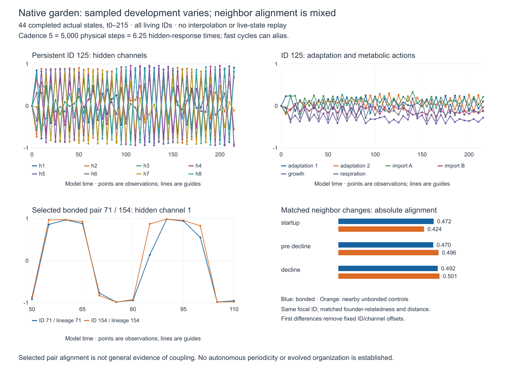

# Native garden: development and neighboring changes

The completed observations through time 215 show broad **within-ID developmental
variation**, rather than a population settling into fixed saturated hidden
states. Adaptation, actions and derived metabolic shares vary alongside hidden
state. Some bonded pairs have strongly aligned sampled changes, but nearby
nonbonded controls do not support a general stronger temporal relationship
among bonded neighbors in this record.

The readout freezes 44 unique completed observations from time 0 to
215.00001021. Each includes every living cell; population rises from 256 to 259
then falls to 43. Five duplicate 32³/64³ exports were checked to have identical
cell/bond states and counted once. Binary hashes and source identities match.
The source is commit `4b747919ec56f535f7c37bc7c666bd423316162d`; no live state was
advanced, replayed or changed for this analysis.

**Cadence is the main temporal limitation:** observations are five model-time
units apart, or 5,000 physical steps. That is 6.25 hidden-response times (`.8`)
and .625 adaptation times (`8`). Constant sampling can alias fast dynamics;
periods below ten cannot be resolved, and the visible alternation is not a
measurement of an autonomous cycle.

## Individual development

The native controller evaluates inherited weights plus plastic marks through
`tanh`. Hidden state approaches an adaptation-inhibited target; adaptation follows
hidden state. Bonded neighbors contribute gated hidden inputs. Only hidden-output
rows acquire the bounded developmental marks. Actions respond to controller
inputs, so varying actions do not by themselves demonstrate intrinsic oscillation.

For each window, identities with at least six samples qualify. Standard deviation
is computed within ID and channel, combined across channels, then summarized by
the median across qualifying IDs. This removes fixed ID/channel offsets.

| Window | Qualifying IDs / present throughout window | Hidden std | Adaptation std | Action std | Hidden saturation fraction |
| --- | ---: | ---: | ---: | ---: | ---: |
| 0–50 | 256 / 256 | .746 | .287 | .237 | .080 |
| 50–110 | 259 / 258 | .819 | .368 | .242 | .221 |
| 110–215 | 206 / 43 | .837 | .392 | .246 | .228 |

Saturation means `abs(hidden)>.95`; its table entry is the median within-ID
fraction. Every qualifying identity changes at least one hidden sign in its
window. The decline window's qualifying cohort includes cells later lost; the
43 complete-window survivors are explicitly distinguished. ID 125 in the figure
was selected after inspection for many sampled sign changes among identities
present throughout the record, not as a representative random cell.

## Neighbor relationships

The comparison uses simultaneous hidden first differences over each five-unit
interval, reciprocal bonds present at both endpoints, and a nearby unbonded
control sharing the same focal cell and founder-relatedness class. Distance is
measured relative to summed cell radii; accepted control matches differ by at
most .25 in that normalized distance. Both cells must have RMS hidden change
at least .01. Controls can be reused; these are dependent descriptive comparisons.

There are 3,683 directed matched comparisons. Coverage is limited: startup matches
486 of 3,068 eligible directed bonds, pre-decline 2,217 of 8,532, and decline
980 of 4,390. All accepted comparisons are between different founder lineages.
First differences remove fixed offsets but retain inherited dynamical biases,
common food/mechanical forcing and division effects.

Mean absolute change alignment (cosine, averaged within focal-ID/time first) is
`.472/.424` for bonded/control pairs at startup, `.470/.496` pre-decline, and
`.492/.501` during decline. Signed bonded-minus-control differences are small:
`.048`, `.023`, `.041`. Thus selected pair alignment should not be generalized
to the garden as a whole.

For example, cross-lineage IDs 71/154 remain bonded at all 13 observations from
50–110 and have centered first-difference correlation `.969`. Circularly shifting
one ID's difference sequence reduces this example's alignment (shift correlations
range −.758 to .696), while other selected pairs retain large shifted alignments.
This checks temporal alignment beyond fixed sign offsets; it is neither a
significance test nor evidence that the bond causes synchronization. Endpoint
bonds can also disappear and reform between captures.

[Compact evidence and hashes](native-garden-development.json),
[selected exact plotted values](figures/native-garden-development.csv), and the
[vector figure](figures/native-garden-development.svg) accompany this report.
Derived readouts are retained under
`outputs/native-development-analysis-4b747919ec56-t215-v2`; completed exports are
unchanged. The result is sampled material activity with heterogeneous temporal
relationships, not a claim of evolved organization or adaptation.
