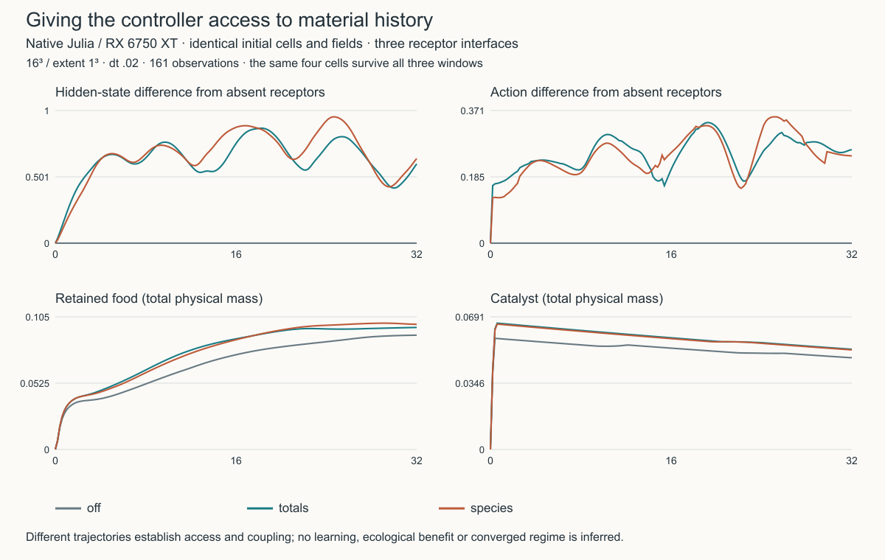

# Material history becomes controller input

The native constructive composition can now expose three chosen habitat
observations to the inherited recurrent controller. This is a new experimental
receptor interface, not a learned credit rule. Existing recipes omit it and keep
their numerical path and habitat parameter schema: no extra kernel is launched.

Slots16–18 were zero in the native cellular sensory block. They are filled after
ordinary sensing, before either controller execution path. Free A/B, free-food
gradients, stores, energy, contact and age retain their existing slots. The
construction readout retains its independent existing raw/catalyst observations.

The [study profile](../experiments/native/constructed-garden-material-sensing-64.toml)
uses **raw total, retained-food total, catalyst total**. These distinguish
unprocessed opportunity, stored accessible-in-the-future food and persistent
construction. They intentionally do not distinguish A from B. Each slot can
instead select a species, sum or signed A−B difference from any of the three
pools; the vocabulary has twelve choices. For example `raw_a, raw_b, bound_total`
retains raw-resource complementarity and omits direct catalyst sensing. A limited
receptor budget is an explicit experimental choice, not an architectural claim
that these three statistics capture the full material state.

```toml
[material_sensing]
channels = ["raw_total", "bound_total", "catalyst_total"]
scales = [4.0, 0.02, 0.004]
```

Every channel averages concentration over the same cell support as uptake, then
applies `c/(scale+abs(c))`. Scales are fixed positive physical concentrations;
none uses run maxima, current population statistics or a rendering normalization.
A positive scale gives response½ at that concentration, signed balances range
between−1 and1. Scaling the voxel inventory with voxel volume preserves a uniform
physical signal. Receptor outputs match Float32 controller precision;
physical inventories, transfers and accounting remain untouched. The raw scale4
matches the profile's initial A+B. Bound.02/catalyst.004 are explicit exploratory
scales near the supply-matching estimates, not calibrated receptor optima.

The implementation uses one device kernel, no host transfers, new resident arrays
or controller dimension changes. Codes/scales are concrete tuples in the habitat
parameters and survive strict checkpoint/restore. Invalid codes/scales are
rejected; active/status masks apply. The graph-enqueue and slow-material study
hooks forward the receptor stage, so choosing a different execution schedule does
not silently remove sensing. Source-pin requirements still prohibit loading an
old historical checkpoint into changed source.

## What to test next

A matched sensing comparison asks whether access changes development; it does not
ask whether access is useful. Receptor weights were random inherited coefficients
before these channels became active. A first effect can therefore be saturation,
changed gain or worse decisions. Compare totals/species/absent receptors, crossed
with clocks/gains, under withheld perturbation histories. Useful memory requires
prediction or improved action under a declared challenge. Stronger responses alone
are not the objective.

Action/readout plasticity is deliberately deferred. The current local hidden-mark
rule has no outcome signal or eligibility trace, so copying it onto action rows
would add gain adaptation without establishing ecological credit. A coherent
separate law could pair bounded eligibility traces of pre/post activity with a
slow, locally available physiological innovation signal (e.g. realized uptake
minus a cell-specific expectation), and explicitly charge/track adaptation costs.
Its baseline, delayed-credit horizon, inheritance semantics and matched no-credit
control should be specified before implementation. Even that signal would select
uptake efficiency rather than arbitrary desired morphology; outer repertoire
search remains a separate instrument.

## Native comparison, 15 October 2026



Three fresh16³ / extent1³ trajectories use the same four founders, physical
concentrations and per-volume source budgets. The receptor choices are absent,
three totals, or rawA/rawB/bound-total with scales2/2/.02. They advance32 modeltime
at dt.02 and observe every.2. All four IDs persist; the maximum absolute material
residual is1.78e−15, potential1.87e−12. CPU/native100-step parity has maximum
input/hidden error8.94e−8; strict GPU restoration is exact. The large timestep is
an assay setting, not a converged replacement for the native production.001.

| Receptors | Final hidden RMS difference from absent | Final action RMS difference | Final retained food | Final catalyst |
|---|---:|---:|---:|---:|
| Absent | 0 | 0 | .09054 | .04780 |
| Three totals | .5987 | .2613 | .09666 | .05224 |
| RawA/rawB/bound total | .6393 | .2440 | .09913 | .05191 |

These windows demonstrate that the new inputs participate in recurrent and
physical feedback. They do not establish useful memory, a preferred receptor
allocation, learning, selected organization or a beneficial outcome. Both sensing
arms alter the initial paid construction transient; later differences include
that changed environment, not solely an isolated recurrent sensitivity. One seed
and four cells do not sample the repertoire. A moderate range of concentration
scales and fixed-trace/replayed sensory controls should follow; receptor saturation
is itself measurable and may suppress fine distinctions. In the totals arm,
46.7% of postinitial cell-observations have catalyst receptor response above.95
(retained-food receptor8.9%, raw receptor0%). That scale is a useful next knob;
current strong responses should not be mistaken for high information capacity.

At native64³ /256 founders/16384 capacity, complete steps cost **8.300ms absent →
8.392ms totals (+1.11%)**, with no new resident state arrays. Each median covers
three200-step samples after100 warm steps at dt.001, F64 inventories and batteries.
Sample means span8.27–9.14ms without receptors and8.36–9.26ms with them.
This variability exceeds the small overhead, so this is an overhead estimate,
not a precise performance regression threshold. Accounting remains below1.2e−12
material /3.8e−12 potential after700steps. The device is RX6750XT, Julia1.12.4,
process-local AMD optlevel1 workaround, CPU10–11,8GiB/no swap/nice15 and900-second
wall cap. No job remains running.

[Compact evidence and configurations](figures/native-material-sensing.json),
[plotted values](figures/native-material-sensing.csv), and
[reproducible probe](../scripts/probe_material_sensing.jl) are retained. Full traces
and logs are in `outputs/material-sensing-20261015`; immutable host stage is
`/othersys/tmp/intmat-probe-20261014/material-sensing-v2-20261015`. Source hashes
match the current production files. The first stage is preserved: the parity gate
passed, but the study wrapper forgot to zero unrelated default World nutrient
before strict restore; restore correctly refused it. Only the wrapper was fixed
for the next new run; no checkpoint was migrated or resumed.

Focused CPU gates pass27 receptor/serial-restart assertions and10 independent
batch/restore assertions, including unequal raw fields across worlds. The new
array descriptor remains compatible with the batch kernel generator.
