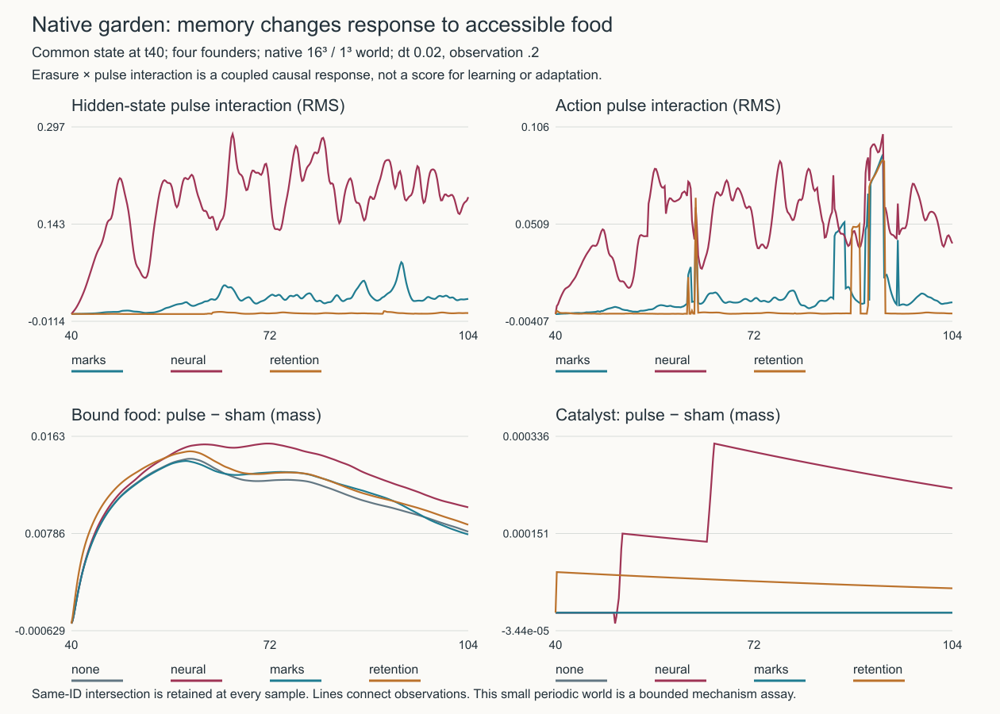
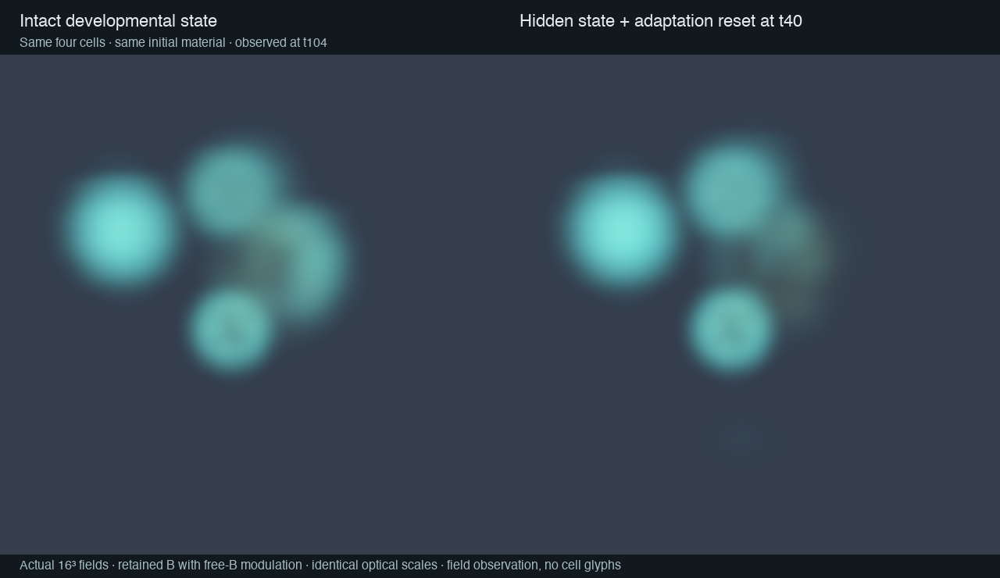

# Causal memory and context in the native garden

The [matched branch assay](../studies/native_memory_interventions.jl) tests whether
stored cellular and environmental states change the response to a new food-access
perturbation. It advances the actual `DeviceConstructiveEcology` composition on
CPU, restores an identical complete checkpoint for every arm, and retains dense
same-identity observations. This is a new experiment, independent of every
existing garden and checkpoint.

## Bounded result, 15 October 2026



All eight branches completed the t40–104 response window. The same four IDs
survived throughout every branch; there were no births or deaths in this window.
The intact baseline already had within-ID/channel hidden standard deviations
.728–.852. These interventions test response in an active developmental system,
not whether a reset can rescue absent activity.

| State reset | Hidden interaction RMS over window | Final hidden interaction RMS | Action interaction RMS over window | Peak action interaction RMS |
|---|---:|---:|---:|---:|
| Hidden + adaptation | .1890 | .1859 | .05587 | .1018 |
| Plastic marks | .02600 | .02418 | .01995 | .09034 |
| Bound food release | .001385 | .001606 | .01831 | .08707 |

The reported window RMS weights the 321 equally spaced observations equally.
Joint neural/adaptation reset produces the strongest persistent hidden response
interaction in this state. Mark reset also changes later food response despite
leaving the initial recurrent state intact. Retention release has much smaller
hidden interaction, while its action trace contains brief spikes. Those spikes
have not been localized to individual sensory/contact versus recurrent pathways;
a peak alone would exaggerate its persistent effect. No ranking of biological
importance or useful memory follows from these different, unnormalized edits.

Material changes are slower and smaller than the neural differences. In the
intact sham branch catalyst mass falls .04493→.02692, bound food .09243→.07977,
and free food .1810→.09024; raw inventory increases 4.938→6.748. At t104,
neural-reset sham has bound food .07470 and free food .10480. Retention-release
sham nearly rejoins the intact partition, ending at bound .07936/free .08948.
The source-funded material continues to change, so these are coupled responses,
not isolated decay constants or a demonstration that a neural variable retains
a food memory for 64 time units.

The largest final absolute material residual is 1.082e−7 and potential residual
7.018e−8; event rounding jumps are below 2.7e−10 material/1.1e−9 potential.
Strict branch restoration, finite-state checks and native step guards passed.
A half-step convergence comparison has **not** been run, so quantitative peak
sizes and timings should not select a production law by themselves.

[Compact results and input hashes](figures/native-memory-interventions.json),
[exact plotted values](figures/native-memory-interventions.csv), and
[SVG](figures/native-memory-interventions.svg) are retained. Full traces and
actual 16³ fields before and after each branch are under
`outputs/native-memory-interventions-20261015`. The executed driver copy hashes to
`73fc83f4ed61edd37ec679014f98a7c45ccf32b7588fc5ef84b9101280ece5ad`.
This run used the integrating working tree during the inventory-precision work;
its report pins the loaded habitat source, but did not retain the cellular source
pin or an immutable whole-source archive. It is therefore bounded implementation
evidence, not an immutable-source production comparison. The current runner adds
loaded cellular pins, runtime inventory types, factory hash and automatic driver
preservation for subsequent assays; its numerical intervention/advance law is
unchanged.



The two t104 fields use identical optics: retained B sets density and absorption;
cyan emission is normalized retained B multiplied by the square root of normalized
free B. Both normalizers are shared maxima across the pair. These are smooth
16³ diagnostic volumes, without added cells, texture, geometry or resolution.
The modest spatial difference is preserved rather than amplified independently.
[Optical metadata](figures/native-memory-material.optical.json) records source
hashes and renderer settings. Reproduce the raw paired views with
`julia --project=. --threads=4 studies/render_memory_material.jl ASSAY_DIRECTORY FRESH_OUTPUT`.

## What the intervention measures

The eight branches cross four memory conditions with a sham or accessibility
pulse. All ordinary steps, including division, mutation, construction, sorption,
transport, mechanics and finite source funding, use the native implementation.

| Condition | One-time state change | Retained state/law |
|---|---|---|
| Intact | None | All state |
| Neural reset | Hidden state and adaptation set to zero | Genomes, plastic marks, physiology, habitat |
| Mark reset | Developmental marks set to zero | Recurrent and adaptive state, genomes, habitat |
| Retention release | Bound precursor moved into the same site's free precursor | Scaffold, future binding, transport resistance, total material and potential |

The pulse converts ten percent of each raw precursor inventory in the half-world
`x<Lx/2` into the corresponding soluble precursor. Raw and soluble potential are
both four in this recipe. It changes accessibility without adding food, energy,
or funding. Retention release is a partition perturbation, not a permanent
sorption knockout or scaffold erasure; it necessarily changes free food too.
Mark erasure also changes recurrent gain; an effect of erasure does not by itself
show that the erased pattern stored useful information. All physical interventions record their actual material/potential rounding jump,
then measure subsequent ledger residuals relative to the intervened state.

For a hidden or action component `y`, the interaction is

```
[y(erased,pulse) - y(erased,sham)] - [y(intact,pulse) - y(intact,sham)].
```

The reported RMS is computed across components and IDs present in all four
branches at that time. IDs and cohort sizes are retained: replacement of cells
cannot silently become neural response. This is a causal effect of the specified
state edits on pulse response in these simulated states. A nonzero interaction
shows context sensitivity; it does not establish useful learning, adaptive
benefit, an attractor, criticality, or selection. It also does not separate
recurrent hidden memory from inhibitory adaptation, which the neural arm resets
jointly. Later branch divergence can include altered movement and chemistry;
it is a total coupled effect, not a direct neuronal transfer function.

## Scope and resolution

The bounded study uses the [native recipe](../experiments/native/constructed-garden-64.toml)
in a 16³ grid of extent 1³, with four founders and capacity 256. Its .0625 voxel
spacing, physical body density, exchange radius, concentrations, source funding
per volume and nominal funding duration match the 64³/4³ recipe. Opposed raw
patches span the smaller periodic domain, so their physical gradients and the
available long spatial modes differ. Four founders are not a representative
population sample. Results characterize this assay rather than predict the
completed garden's ecology.

The measured preparation is 40 time units; the post-intervention window is 64, at
`dt=.02` and observation spacing `.2`. Thus a response time `.8` gets four
observations and an adaptation time `8` gets forty. The numerical step is twenty
times the production `.001`; it passes the native guard but is a study setting,
not a demonstrated converged substitute. A half-step repeat is the appropriate
check on any quantitative difference used to choose a production regime. The
64-unit response window exceeds one roughly 45–50 mark relaxation time but is
shorter than the 125 catalyst lifetime; failure to recover within it is censored
rather than infinite memory.

Fresh output is required:

```sh
JULIA_NUM_THREADS=1 OPENBLAS_NUM_THREADS=1 julia --project=. \
  studies/native_memory_interventions.jl \
  experiments/native/constructed-garden-64.toml FRESH_DIRECTORY 40 64 .02
```

Every branch begins with an exact snapshot-equality assertion after strict
native restoration. A source pin, recipe and study hashes, effective config,
intervention jumps, per-branch traces, final accounting errors and matched
interaction time series are written. No large baked checkpoint is committed.

## Distinct routes to memory and change

The [native sense/regulate stages](../src/device_cellular_kernels.jl) assemble
self hidden state, gated bonded-neighbor hidden state, extracellular free food
and gradients, intracellular stores, energy, mass, contact state and age. Hidden
state relaxes toward a recurrent nonlinear target; adaptation follows the updated
hidden state and inhibits its later target. This is dynamical state memory even
when every weight is fixed. A responsive recurrent trajectory alone is not
within-lifetime learning.

The bounded plastic marks modify only hidden-output rows. Their local
activity/input update changes future development during a lifetime, without a
reward signal or task objective. This is within-lifetime plasticity, but improved
performance must be demonstrated separately. Action rows and the independent
catalytic readout do not acquire these marks. Marks can still affect actions and
construction through changed hidden inputs.

At [division](../src/device_cellular_kernels.jl), the child copies the parent's
marks and adaptation, inherits hidden state with a small partition perturbation,
and receives a mutated inherited genome. The catalytic readout has its own
inheritance/mutation path in [the habitat kernels](../src/device_habitat_kernels.jl).
Thus heredity includes both encoded weights and transmitted developed state.
Inheritance is not selection; selection is not yet evidence of adaptation to a
specified challenge. A selected-adaptation assay needs descendant genomes tested
against ancestors in matched environments, preferably separating inherited marks
and physiological state from genetic effects.

[Paid construction](../src/constructive_cells.jl) competes with growth for the
same complementary material and work budget. The native implementation preserves
that allocation in [the device habitat](../src/device_habitat.jl). Catalyst stores
spatial history, unlocks raw food, provides [binding sites](../src/sorptive_matrix.jl)
and reduces transport. Those changes feed back to sensing, import and future
construction. Retained food is unavailable to uptake until release. Neither
scaffold persistence nor heritable marks alone proves a ratchet: accumulation
can plateau, decay, saturate or be costly.

The useful architectural next step is to make **common-state intervention and
identity-resolved response** a reusable study boundary before adding new laws.
This runner supplies that boundary without duplicating the simulation. It can
refute a proposed memory mechanism while leaving the richer native system intact.
For richer learning, a subsequent experimental law could allow slower, bounded
plasticity of action/readout couplings driven by a local physiological signal;
that introduces a new learning rule and should be evaluated in fresh branches,
not silently interpreted as a capability of the current rule. For developmental
differentiation, compare context sensitivity and persistent within-lineage roles
under the same environment, rather than treating high variance or oscillation as
the target. For ecological ratcheting, measure descendant access to constructed
material and recovery after perturbation across generations, with source budget,
ancestry and environment controls.
