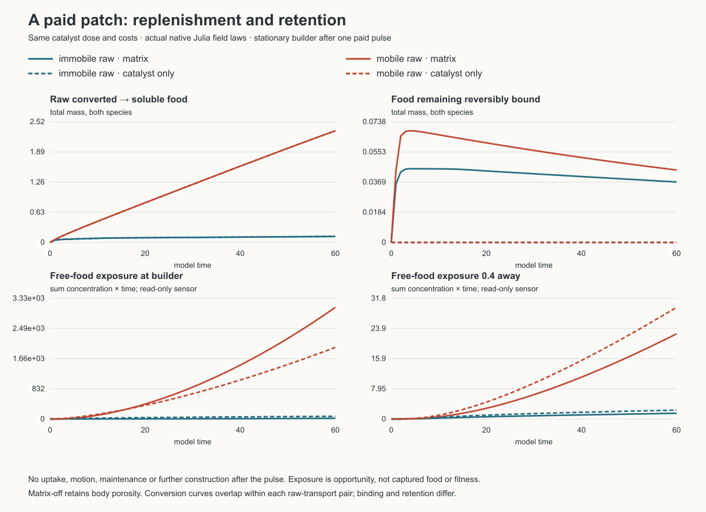
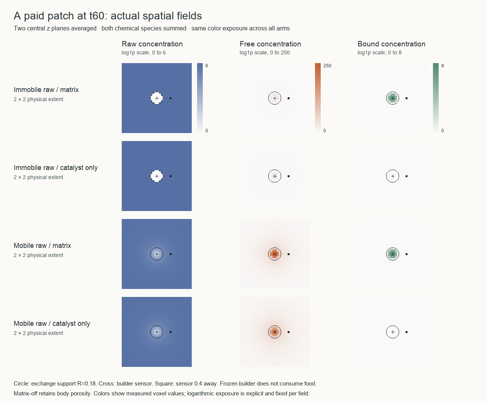

# Paid patches and spatial access

This study asks a geometric question about the native constructed garden: how much useful food can a paid, localized catalyst patch make available, and where does that food remain? It does not test evolution, cooperation, or population persistence. The live garden and its immutable source are unchanged.

## The coupled law

Cells pay complementary intracellular precursors and work for growth and extracellular catalysts from one proportional anabolic budget. A catalyst releases its corresponding soluble precursor from raw feedstock, stays where it was deposited, and decays to waste. It also supplies reversible binding capacity and reduces soluble transport. Bound food cannot be imported until it desorbs. Raw food has its own transport coefficient; the garden sets that coefficient to zero. The matrix has no ancestry test and no native mechanical anchoring. The CPU-only MatrixDrag law is absent here.

This creates several possible routes to localized benefit. A stationary builder can revisit its own food store; nearby descendants or bonded partners can share a persistent patch; movements can lay chemical trails; two catalytic specializations can exchange complementary precursors through contacts. Benefits depend on physical overlap and access, not a colony reward. Conversely, food can be retained where no cell remains, binding can temporarily reduce immediately importable food, and a transport barrier can impede both useful escape and replenishment. None of these signs is fixed by the existence of a public good alone.

The main native controller senses soluble food, intracellular stores, battery, size, contacts and neighboring hidden state. It does not directly sense raw food, catalyst or bound food. The inherited secretion readout does sense raw food and catalyst in addition to hidden and intracellular state. Thus raw access can regulate construction directly, while steering responds indirectly through released food and development. This is a genuine interface constraint, not a proof that indirect adaptation cannot work. Mutation changes both controller and secretion genomes; plastic marks and slow adaptation give within-life dynamics. Both catalyst types still require both internal precursors, so catalytic specialization is an allocation tradeoff rather than an imposed biosynthetic dependency.

## Scales in the actual recipe

These estimates use native source `4b747919ec56f535f7c37bc7c666bd423316162d` and `experiments/native/constructed-garden-64.toml`. Concentrations are mass per physical volume, source rates in the recipe are world totals, and all times are model times.

| Quantity | Value | Consequence |
|---|---:|---|
| Exchange/construction radius R | 0.18 | One support sphere has volume 0.02443. |
| Soluble diffusion D | 0.006 | R²/D = 5.4; radial RMS crossing R²/(6D) = 0.9 before transport resistance. |
| Raw diffusion | 0 | A stationary catalyst cannot recruit raw food from outside its footprint by diffusion. |
| Nominal motor speed | 0.06 | R/speed = 3, before energy/contact limitations. |
| Hidden / adaptation time | 0.8 / 8 | Development can vary on the same broad scale as local transport. |
| Catalyst decay | 0.008 | Lifetime 125; chemical memory can outlive residence. |
| Binding on/off | 4 / 0.12 | Kd = 0.03; off-time 8.33. |
| Matrix capacity / resistance | 6 / 20 | Capacity is 6e per species; matrix permeability is 1/(1+20(eA+eB)). |
| Basal work, founder | 1.6 × 0.008 = 0.0128/time | Neural, motor and anabolic work are additional. |

At fixed catalyst concentration e, binding equilibrium is b = 6e f/(0.03+f). The local-equilibrium retardation factor is 1 + 6e·0.03/(0.03+f)², approaching 1+200e at low free concentration. This approximation separates binding from the additional matrix/body transport resistance; it is not the exact transient solver.

The two opposed raw-source masks have constant summed concentration supply 2/64. A stationary support sphere therefore receives at most 2·(1/64)·0.02443·4·0.65 = **0.001985 useful work/time** from its ongoing raw supply, even if both species are completely converted and respired without other costs. This is 15.5% of founder basal work. A nonoverlapping population of 256 such spheres covers at most 9.77% of the domain. The global supply could fund 5.2 work/time only if sufficiently much of its spatial distribution becomes accessible. Motion and persistent trails can enlarge that footprint; soluble food can diffuse into current cell supports. The current support bound therefore does **not** bound all food a moving cell can obtain.

Body porosity matters separately. The normalized support kernel is proportional to (1−r²/R²)², whose three-dimensional integral is 32πR³/105. An isolated initial body plus stores (mass 1.84) gives a continuum center occupancy near 329 and body permeability near 0.005 with packing barrier 0.6. The physical density parameter sets the contact radius but does not divide this occupancy. Matrix resistance multiplies body permeability. Dense bodies can therefore remain strongly isolated in chemical transport even when contact spheres are small. The discrete kernel and overlaps determine actual values.

The nominal Péclet ratio vR/D is 1.8 before resistance; local resistance can make transport slow relative to cell motion. The ratio of catalyst lifetime to nominal support-crossing time is about 42. A cell can leave a long-lived patch well before it decays. Bonds, reduced motility, chemotaxis toward released food, or revisitation could change residence; none is guaranteed by paying for construction. In particular, a large catalyst inventory is not the same observation as a large catalyst inventory under living bodies.

These are parameter and spatial-access constraints. They do not establish that the substrate cannot develop organization. They suggest an explicit route worth testing: raw transport can connect remote stock to persistent constructed patches, while reversible retention changes who can access the released product and when.

## Controlled intervention

`studies/paid_patch_access.jl` uses the actual native Julia kernels on one CPU thread. Four arms cross raw diffusion 0 versus 0.006 with full matrix versus catalysis alone. Every arm starts with one identical funded builder and uses the same actual anabolic allocator to pay 0.006 catalyst mass of each type. Body porosity remains present in all arms. Matrix-off removes binding capacity and matrix transport resistance together; it does not remove catalysis or body porosity.

After this pulse the builder is frozen: no uptake, upkeep, growth, motion, death, division or further construction. Raw and soluble fields, catalyst decay, binding, transport, finite source budgets and their material/work ledgers continue. Initial free food is zero and raw food is 2 per species. The 32³ periodic domain has extent 2 and the same 0.0625 spacing as the native garden. Uniform raw supply matches the garden's mean concentration rate, funded for 80 time units; the assay observes 60. The spatial niche contrast is deliberately absent to isolate transport. The timestep is 0.02, checked against the coupled diffusion limit; this is an assay timestep, not a claimed native trajectory equivalence.

Read-only normalized radius-0.18 sensors at the builder and 0.4 away measure free-food exposure (concentration × time). They do not consume food. Exposure therefore measures an opportunity for access, not realized capture, fitness, or exclusive builder benefit. A no-uptake assay may exaggerate accumulation and binding saturation compared with a living consumer. It also cannot show whether a learned controller or descendants retain a patch.

The total pulse converts 0.012 precursor mass into zero-potential catalyst, dissipating about 0.048 chemical energy and paying 0.0024 work. If those precursors could instead be respired at efficiency 0.65, the opportunity cost is about 0.0336 usable work including construction. The ideal saturated catalytic output per catalyst over one lifetime is kcat/decay = 750 mass/mass, but finite local raw stock and replenishment—not that upper bound—control realized return.

## Evidence and provenance

All four arms completed to t=59.9999987 on one CPU thread. Their **actual** paid pulse was identical: 0.005999999499 catalyst mass of each type, 0.002399999835 work and 0.04800009727 dissipated chemical energy. The same finite source rates and budgets were used; actual floating-point supplied totals differ slightly (14.991782 immobile versus 14.991878 mobile), a 0.000096 difference that is far below the conversion contrast. Matrix-on/off supply totals match exactly within each raw-transport pair.

| Raw transport / matrix | Converted food, A+B | Bound food at t60, A+B | Near free exposure, A+B | Far free exposure, A+B |
|---|---:|---:|---:|---:|
| Immobile / full matrix | 0.125767 | 0.036971 | 19.9228 | 1.5173 |
| Immobile / catalyst only | 0.125766 | 0 | 73.7105 | 2.3496 |
| Mobile / full matrix | 2.335019 | 0.044314 | 3079.7004 | 22.4634 |
| Mobile / catalyst only | 2.335040 | 0 | 1973.8264 | 29.4574 |

Raw diffusion increases conversion **18.57-fold** with the same paid catalyst pulse. Matrix binding/resistance changes conversion only at the small endpoint-rounding scale because it acts downstream of raw conversion. Its access effect changes sign: with immobile raw, near exposure is 0.270× catalyst-only; with mobile raw, near exposure is 1.560× catalyst-only while far exposure is 0.763×. Under replenishment, the matrix makes released food more localized around the fixed builder. Without replenishment, binding can sequester much of a small release. These are concentration-time observations with no consumers; they do not establish a capture advantage or preferred ecological parameters.

The following field figure uses actual saved t60 voxel data, averaging the two central z planes and summing A+B. Every arm shares the same explicit logarithmic exposure for each field; no field interpolation or anatomy was added. The raw depletion hole is confined to the catalyst footprint when raw is immobile. With raw diffusion, the surrounding stock feeds the patch and the free-food distribution extends outward.

The largest absolute material residual is 0.000244 and potential residual 0.000975, both in mobile-raw arms (under 6×10⁻⁶ of their initial-plus-supplied material/potential scales). Immobile-arm residuals are below 4×10⁻⁸. The assay's explicit absolute guards were 0.002 material and 0.008 potential, and all final field nonnegativity/finiteness assertions passed. These numerical checks validate the bounded intervention, not long-horizon accuracy or ecological conclusions. A four-arm t0.04/16³ smoke preceded the full run; no repeated full simulation was needed after the interruption.

Bulk arrays remain outside Git under `outputs/paid-patch-access-20261015`. [The compact result and complete sampled curves](paid-patch-access.json) retain engine hashes, driver/profile hashes, actual costs, audit residuals and the SHA-verified garden readout. Plot drivers are `studies/plot_paid_patch_access.py` and `studies/plot_paid_patch_fields.py`; `studies/export_paid_patch_fields.jl` exports measured slices. Actual garden readouts verify each complete frame against its recorded SHA and never restore or replay the live state.

## What the actual garden frame adds

`studies/native_accessibility_readout.jl` read the native 64³ t100 frame (259 living cells, SHA `16cfaca86fbdc7d2ddfbd7e1ad3b6e85fa09066ad1acdfbf316dcb6ef23af4d7`) without replay. Raw inventory was 409.246, free food 9.728, retained food 6.465 and catalyst 1.627 mass. The current cell-support union covered 9.61% of the world and contained only 0.1818 catalyst mass, **11.17% of all catalyst**. Any positive catalyst occupied 50.92% of voxels, including weak trails. This last fraction is a support statistic, not a claim that all those sites are productive.

Despite a median cell-support raw concentration of 6.976 (A+B), catalyst-weighted substrate saturation was only 0.0239/0.0241 for A/B: **99.18–99.19% of catalyst mass lay at raw concentration below the half-saturation constant**. This is a spatial mismatch that a mean raw inventory hides. The instantaneous conversion law evaluated on recorded fields gives 0.11723/0.11701 mass/time, at most 0.609 useful work/time after 0.65 respiration yield, below basal work demand 3.466. That estimate is not an observed interval flux and does not include stored intracellular energy or all existing soluble/bound food. Median free concentration at cells was 0.00434 and median combined body-plus-matrix permeability 0.01924.

The current-support ongoing-source upper bound is 0.500 useful work/time; the any-positive-catalyst-footprint bound is 2.648. Both ignore unequal species, kinetic insufficiency and other costs. Current supports can receive soluble food made elsewhere, so neither should be read as a per-cell intake bound. The actual frame supports a narrower statement: abundant extracellular inventory, catalyst location, replenishment and current living-cell location are different quantities. This assay demonstrates one mechanism for reconnecting two of them. It does not identify a sole cause of the garden's early decline. That decline was not the trajectory's final outcome: the population later recovered to **93 living cells at t659.992**, according to the completed source-matched manifest. The run stopped on its material accounting guard (+0.247363 against tolerance 0.206432), with energy residual −0.131032 within its 0.687488 tolerance; it did not stop on extinction. The numerical discrepancy is being investigated separately and the run has not been resumed. The t100 snapshot remains a valid time-local geometric observation, but cannot be promoted into a claim of inevitable failure or long-term incapacity. The compact JSON records the completed manifest SHA and final frame identity.

## A separate mechanical route worth developing

The native matrix currently changes chemical transport and binding but not mechanical residence. A cell can leave its paid material behind. A future opt-in dissipative law could set local drag ζ=1+α times support-averaged catalyst concentration and passive velocity F/ζ. An explicit motor choice is essential: a force-driven motor gives velocity u/ζ with drag dissipation proportional to ζ|u/ζ|²; a velocity-command motor instead preserves speed until its higher ζ-dependent cost exhausts available work. The first directly gives slower escape at finite effort. Neither gives an ancestry privilege, and both can trap cells at depleted patches as well as retain access to useful ones.

This must be a new source-pinned law. Native mechanics presently charges a conservative force/curvature motor forecast each substep, while the CPU mechanics law has a different endpoint accounting contract. Changing displacement alone would misprice work. Before implementation, the mobility-weighted stiffness/displacement guard, F64 actual battery debit, passive energy decrease, unequal-drag pair relaxation, lifecycle mapping and checkpoint law metadata need a coherent review. No attraction potential is proposed here: adding binding energy would also require accounting for energy released or absorbed when matrix is built, decays or breaks. Mechanical retention is a next experiment, not a retrospective repair of the live garden or a claimed rescue.
