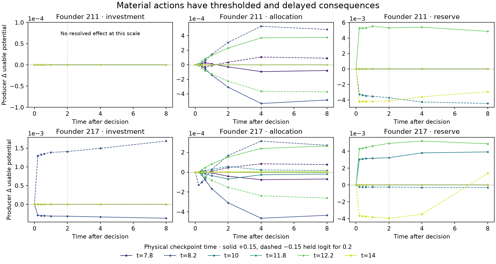

# Marginal consequences of material decisions

A short action can have a delayed, thresholded effect in the existing native chemistry. This assay measures those consequences before choosing a new credit horizon. It does not train from counterfactual branch outcomes.

Two founder banks (211 and 217) develop under the joint reserve/material learner. At physical times 7.8, 8.2, 10, 11.8, 12.2 and 14, each exact physical checkpoint branches into an unperturbed baseline and ±0.15 perturbations to each of producer 1's three held logits: investment, allocation, reserve. Each perturbation lasts 0.2 time. Learned coefficients then remain frozen, with identical future Gaussian innovations across the seven branches. The original source phase, masks, clock and remaining finite budgets are restored; each channel originally had budget 14 and rate 0.5. The latest endpoint is time 22, within the original 28-time supply budget. No source budget is replenished at restart.

The shared Julia schedule and native request helper still determine actual uptake, oxidation, material secretion and payment. The wrapper changes the actual held drive for the decision and restores its saved representation exactly afterward. It does not inject material, alter accounting, or use branch utility as a learning signal. All four original residents remain valid at every recorded sample. All paired external additions match; maximum material/potential audit residual is 7.11e−14. The separate seven-world CPU/AMD parity gate crosses the feed exchange at time 8, with maximum checked difference 2.98e−8 and residual 7.11e−15.

## What changes the design

- **Allocation has a delayed tail.** For founder 211 at time 8.2, the positive pulse changes producer usable potential by −0.000309 at lag 2 and −0.000486 at lag 8. Opposite signs have approximately opposite effects in that context. The context at 12.2 reverses which allocation direction helps.
- **Reserve has nonlinear authority and can reverse sign over time.** For founder 217 at time 14, a negative pulse gives −0.003947 at lag 2 but +0.001377 at lag 8. At lag 0.2 it reduces oxidation by 0.01797, reduces battery by 0.04698, and increases funded secretion by 0.001300. By lag 8, cumulative secretion is slightly below baseline and the positive utility difference is battery. This is a coupled storage/oxidation/material trajectory, not proof that extra secretion itself caused the late benefit. Neighbors' summed utility difference is only 1.05e−7 at lag 8 in this branch.
- **Investment often has no resolved physical effect.** Most contexts are limited by other native resources or priorities. Founder 217 at 8.2 is an exception: the negative investment pulse improves lag-8 utility by 0.001688, while the positive pulse lowers it by 0.000370. A command derivative is not a funded-action derivative.
- **The recurrent feature comparison has a gain confound.** Squared full-feature norms are 3.45–7.69 times the corresponding seven-feature reactive norms at these checkpoints. This does not establish the exact training gradient variance, but makes greater adaptation under the full feature map insufficient evidence for useful memory.

Lines join measured samples; the sign crossing occurs somewhere between sampled lags 4 and 8, not at a measured continuous crossing time. Founder replication shares exploration seed 6201 and is not independent exploration replication. This is one local finite-amplitude assay, not a global policy optimum or evidence of cooperation.

## Next learning law

Use decision-aligned return cohorts with a baseline predicted from information available before each sampled action. For decision j, retain its local features x_j, Gaussian innovation ε_j, starting usable potential U_j and baseline b_j. At horizon H, apply the score factor x_j ε_j / σ² to U_{j+H}−U_j−b_j. Train the predictor against the same cohort's stored pre-action features. This allows an H=8 return to include the measured delayed tail without subtracting a fresh baseline that already observes consequences of the old action.

Do not merely keep the old eligibility trace while using each next window's baseline. Do not automatically divide the actor rate by the number of decisions: ηRΣg and ΣηRg have equal unclipped aggregate updates when their targets agree. Instead measure actual proposed increments, clipping, funded coefficient changes and logit displacement; predictor cadence and total variation payment need explicit matching. Compare H=2 and H=8 under the same finite physical schedule, common innovation seeds, and matched frozen/erased probes. A longer horizon can also add variance and nonstationarity; this map motivates that experiment without establishing its benefit.

## Reproduction and artifacts

- Driver: `studies/construction_lag_map.jl`; wrapper: `studies/native_construction_lag.jl`; generic batch registration: `studies/construction_lag_world_batches.jl`.
- Tests: `test/native_construction_lag.jl` (28 checks), `test/construction_lag_world_batches.jl` (25 checks, including restart during pulse and mismatched-clock rejection).
- Native gate and map: `scripts/probe_construction_lag.jl`; frozen execution copies in `studies/outputs/native-construction-lag/`.
- Compact measured traces and paired deltas: `docs/figures/native-construction-lag.json`; parity summary: `docs/figures/native-construction-lag-gpu.json`. The compact artifact includes source pins and raw-report hash, excludes private physical checkpoints, and retains measured absolute quantities beside differences.
- Packaging: `scripts/compact_construction_lag.py`; plotting: `scripts/plot_construction_lag.py`.

The artistic implication is concrete: an interior can carry consequences beyond the immediate decision window, and the same material gesture can help or hurt depending on its physical history. A learner needs access to that delayed consequence before this becomes a usable compositional capability.
