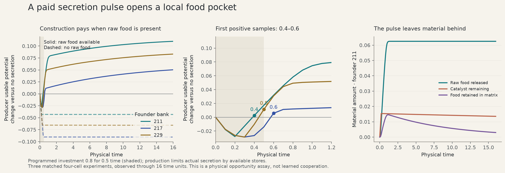

# A paid constructive act with measurable payback

A short secretion pulse can create a local food reserve in the native material.
Across three founder banks, the producer first has more usable potential than its
matched no-secretion control at sampled times 0.4, 0.6, and 0.5. That advantage
persists through the observed endpoint at time 16. The same commanded pulse with
no raw substrate remains costly. This establishes a constructive opportunity for
learning to exploit; it is not itself learned behavior or cooperative fitness.

The [study](../../studies/native_secretion_payback.jl) uses four immobile,
nondividing founders in an 8³ closed habitat. Both free precursors start at
concentration 0.03. Raw substrate is either absent or present at concentration 2
per species; source and sink budgets are zero. Each pulse/control pair restores
exactly the same physical checkpoint. The producer is resident 1. Its investment
is commanded to 0.8 for 0.5 time units, with equal allocation to the two catalysts;
all other residents and the control receive zero investment. Ordinary uptake,
metabolism, material synthesis, secretion payment, deposition, sorption, decay,
transport and mechanics still execute through the production schedule.

Secretion is the habitat's separate three-row regulator, not a cellular action
row. The study wraps its prepare hook and replaces the requested investment and
allocation. Native substrate/energy affordability limits actual deposition.
No material is erased and no controller gets an external energy grant.

| Founder bank | First positive private sample | Private gain at 16 | Neighbor gain at 16 |
|---|---:|---:|---:|
| 211 | 0.4 | +0.109845 | +0.000599 |
| 217 | 0.6 | +0.050288 | +0.000418 |
| 229 | 0.5 | +0.083146 | +0.000339 |

Usable potential is battery energy plus the metabolically usable fraction of
stored precursor potential. Gains are pulse minus no-secretion at the same time;
private means resident 1, and neighbors means residents 2–4 summed. Observation
cadence is 0.1, so these are first positive samples, not exact continuous crossing
times. Neighbor gains are small: this recipe primarily supports private harvest.
Without raw substrate, final private differences are −0.043209, −0.090483 and
−0.065762 respectively.

For founder 211, stores fund secretion only through roughly time 0.2 despite the
0.5 command. The total deposited catalyst mass is 0.01536, with 0.003072 work
spent in addition to the consumed precursor potential. By time 16, the pulse has
released 0.0625 raw material, retains 0.013524 catalyst and 0.002962 bound food,
and increases the producer's cumulative uptake by about 0.05879. Funding duration
and dose differ in the other banks and can differ between raw/no-raw conditions;
the experiment matches commanded actions, not an artificially forced dose.
The two-unit credit window used in the earlier lifetime study already spans this
particular payback lag. A much longer trace is not justified by this geometry.

The [retained measurements](../figures/native-secretion-payback.json) contain exact
sampled observations through time 2 at cadence 0.1, then cadence 0.5 through 16,
with full-report hashes and source pins. [Material frames](../figures/native-secretion-material-frames.json)
show actual 8³ raw/catalyst/bound/free concentrations at times 0, 0.2, 0.4, 1, 4,
and 16 for founder 211 with raw substrate. No temporal interpolation is required.
The [plot script](../../scripts/plot_secretion_payback.py) reproduces the figure.

The [CPU/AMD gate](../figures/native-secretion-payback-gpu.json) compares pulse and
control, raw present/absent, and physics timesteps 0.02/0.01. Maximum observable
discrepancy is 7.78e−10, physical residual is at most 2.14e−14, and founder 211's
first positive private sample remains 0.4 at both timesteps. The three banks are
founder replication of a deterministic actuator intervention, not independent
exploration-noise samples.

A useful next material task is repeated, externally accounted raw-feed changes,
with no phase label supplied to the learner. Material turnover can be slower
than the measured constructive payoff yet comparable to the forcing period.
Learning must act on the actual investment/allocation regulator and pay for
persistent changes. Such a task can test adaptive appetite in a changing material
landscape without treating monotonic closed-dish depletion as the only challenge.

After these runs, the identical request conversion was extracted into
`dh_set_requests!`, shared by the native regulator and study actuator. The exact
pre-extraction [executed driver](../../studies/outputs/native-secretion-payback/executed-driver.jl)
is retained. The helper passes 2,592 exact Float32 arithmetic checks, and eight
CPU pulse/control trajectories (raw 0/2, dt 0.02/0.01, horizon 2) match the archived
driver's observations exactly. The historical native gate above retains its
original source pin; it is not relabeled as a test of the later extraction.
